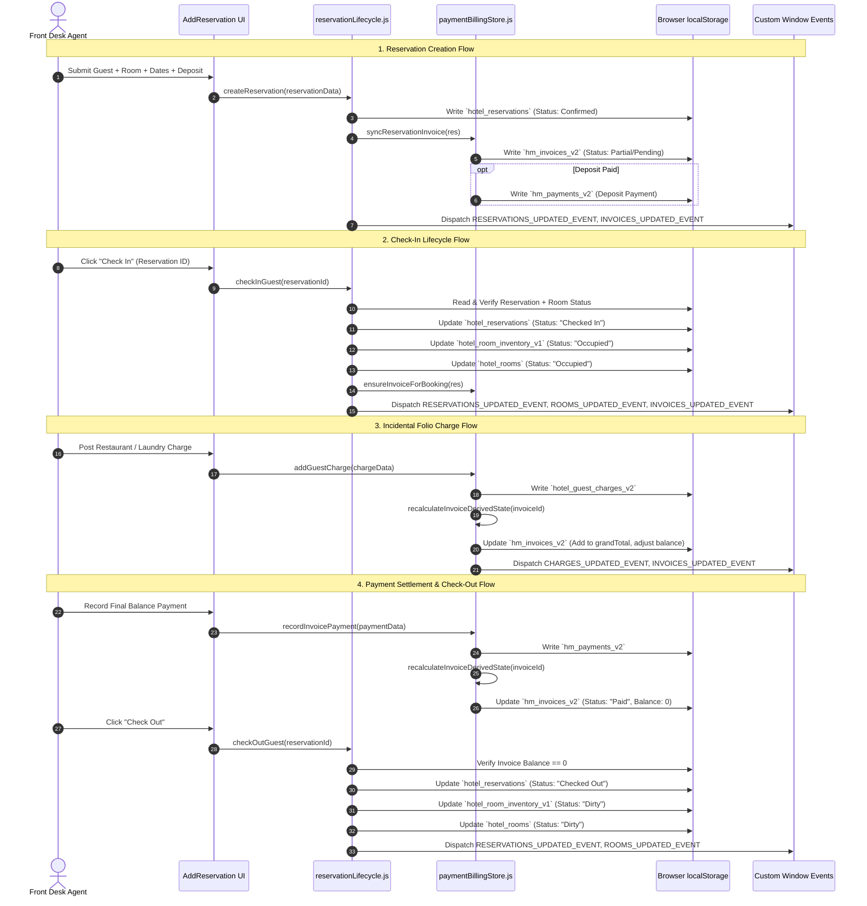
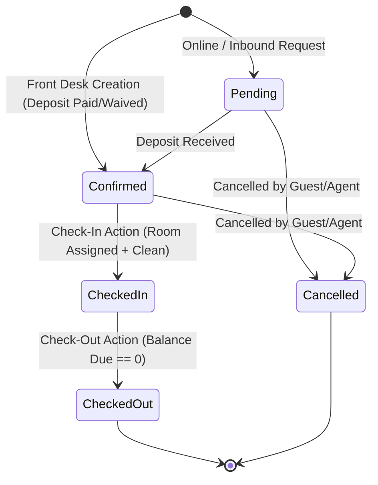
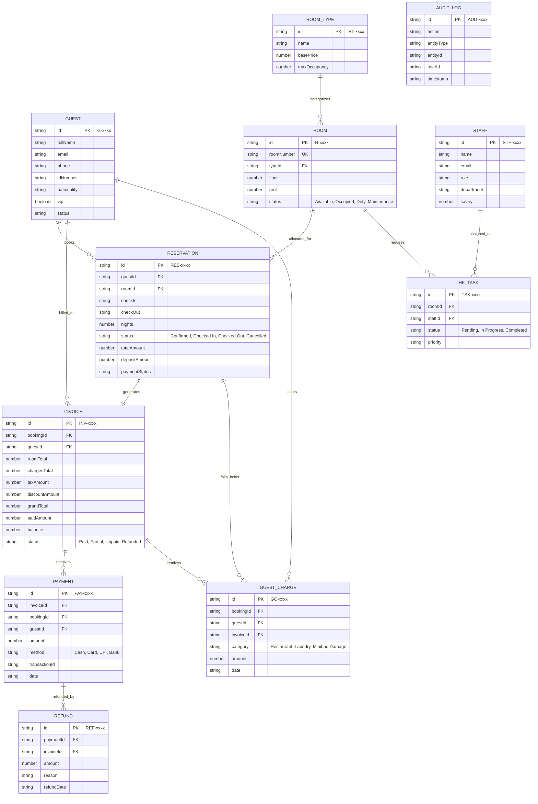
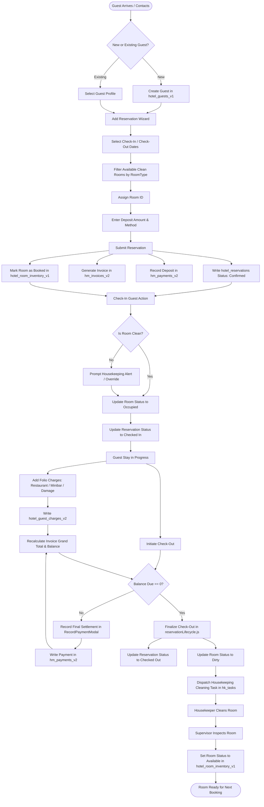

# Hotel Management System — Complete Frontend Reverse-Engineering Documentation

> **CRITICAL ARCHITECTURAL NOTICE:**
> This document describes the **CURRENT FRONTEND IMPLEMENTATION** as it exists in the codebase today. It is a reverse-engineered specification of existing client-side logic, localStorage models, data flows, UI state, reconciliation routines, inconsistencies, and edge-case behaviors.
> 
> It is **NOT** a statement that the current implementation represents the ideal or correct backend architecture. Every architectural flaw, duplicate storage model, loose string matching, or missing foreign key is documented factually under **CURRENT FRONTEND REALITY**, followed by a distinct **BACKEND DESIGN NOTE** to guide backend schema, service, and API design.

---

## SECTION 1 — DOCUMENT PURPOSE & SYSTEM OVERVIEW

### 1.1 Document Purpose
This document serves as the authoritative architectural baseline for designing the backend API, database schema, transactional boundaries, auth services, real-time sync, and reporting engine for the Hotel Management System.

### 1.2 Application Overview
The application is a single-page React hotel management dashboard (PMS — Property Management System) built with React 19, Vite, Tailwind CSS, Lucide icons, and Recharts. It provides a comprehensive front-desk, operational, financial, and administrative interface for managing hotel operations.

### 1.3 Major Business Domains
1. **Front Desk & Reservations:** Booking creation, cascading room type/room allocation, guest assignment, check-in, check-out, cancellations, date extensions, room transfers.
2. **Guest Management:** Guest registry, profiles, ID verification, stay history, guest folios, documents, and complaint tracking.
3. **Room & Inventory Operations:** Room master catalog (`hotel_room_inventory_v1`), operational room occupancy slots (`hotel_rooms`), room status tracking (Clean, Dirty, Inspected, Out of Order, Occupied), amenities, price rates.
4. **Housekeeping:** Room cleaning schedules, cleaning tasks (`hk_tasks`), staff assignments (`hk_staff`), inspection workflows, lost & found registry (`hk_lost_found`).
5. **Financial & Billing Engine:** Invoicing (`hm_invoices_v2`), folio charges (`hotel_guest_charges_v2`), payments (`hm_payments_v2`), refunds (`hm_refunds_v2`), payment allocation, balance due calculations, receipts, and financial audit logs.
6. **Rates & Pricing Configuration:** Seasonal rate plans (`hotel_rates_plans_v2`), promo discounts (`hotel_discounts_v2`), tax rules (`hotel_taxes_v2`), and mandatory/optional fee schedules (`hotel_fees_v2`).
7. **Inventory & Asset Management:** Linen/supplies stock levels, consumable replenishment, missing/damaged item incident reporting (`hotel_inventory_incidents_v2`), guest damage charge generation.
8. **Parking Operations:** Vehicle parking assignments, spot allocations (`hotel_car_parking_spaces_v1`), hourly/daily parking fees, and vehicle registration (`hotel_car_parking_records_v1`).
9. **Staff & HR Operations:** Employee roster (`luxuria_staff_data`), department allocation, attendance tracking, shift scheduling, and salary management.
10. **Front Office / Operations:** Operations Alerts (`operationsAlertService` / MongoDB), Check-In / Out (`stayService` / MongoDB), Guest Complaints (`complaintService` / MongoDB), and legacy prototype digital guest registration cards (`hotel_registration_forms`).
11. **Food & Beverage / Restaurant (In-Memory Demo):** Table reservations, F&B menu orders, room delivery billing.
12. **Events & Banquets (In-Memory Demo):** Banquet hall bookings, corporate/social event schedules, caterer assignments.
13. **Reporting & Analytics:** Revenue reports, occupancy rates, ADR (Average Daily Rate), RevPAR, housekeeping efficiency, financial reconciliations, CSV/PDF export.
14. **System Administration & Audit:** Hotel property settings (`hotel_profile`), cancellation/booking policies (`hotel_policies`), immutable audit trail logs (`hotel_audit_log_v1`).

### 1.4 Current Persistence Mechanism
- **Primary Storage:** Browser `localStorage` using versioned JSON strings (e.g., `hotel_reservations`, `hm_invoices_v2`, `hotel_room_inventory_v1`).
- **Secondary / Volatile Storage:** In-memory module-level arrays (used in `restaurantStore.js`, `eventStore.js`, and some UI mock fallback states) that reset on page reload.
- **Session / Auth Storage:** `localStorage` flags (`isAuthenticated`, `user`, `email`, `fullName`, `userRole`).

### 1.5 Current State-Management Approach
- **No Global State Library:** Redux, Zustand, or MobX are not used.
- **Decentralized Module Stores:** Plain JavaScript modules exporting pure helper functions, query getters, and mutation setters (e.g., `reservationLifecycle.js`, `paymentBillingStore.js`, `guestStore.js`, `roomStore.js`, `hkStore.js`, `inventoryStore.js`).
- **Component-Level React State:** `useState` and `useEffect` load data into component state on mount and subscribe to window events for live synchronization.

### 1.6 Current Event & Synchronization Approach
- **Custom DOM Window Events:** Cross-module updates are communicated synchronously in the same window using `window.dispatchEvent(new CustomEvent(EVENT_NAME, { detail }))`.
- **Standard Storage Events:** Multi-tab synchronization is partially achieved by dispatching native `window.dispatchEvent(new Event('storage'))` and listening to `window.addEventListener('storage', ...)`.

### 1.7 Major Architectural Patterns
- **Synchronous Lifecycle Coordinator Pattern:** `reservationLifecycle.js` acts as an atomic coordinator that updates multiple storage keys simultaneously (e.g., updating reservation status, syncing room occupancy status, generating check-in invoices, and releasing room slots on checkout).
- **Dual-Store Financial Ledger Pattern:** `paymentBillingStore.js` maintains separate stores for invoices, charges, payments, and refunds, providing a deterministic reconciliation function (`recalculateInvoiceDerivedState`) to compute totals, effective paid amounts, refund totals, and balance dues.
- **Optimistic UI with Synchronous Local Rollback:** Functions like `commitLifecycleState` and `recordInvoicePayment` take pre-mutation memory snapshots of localStorage keys and restore them if an exception occurs during the multi-key write cycle.

### 1.8 Important Limitations of Current Frontend Architecture
1. **Browser Sandbox / Single-Device Limitation:** All persistence is tied to the specific browser instance's `localStorage`. No multi-user concurrency or true backend persistence exists.
2. **Dual Room Models:** Rooms exist in two separate keys: `hotel_room_inventory_v1` (authoritative physical inventory with rates and amenities) and `hotel_rooms` (legacy operational room status/occupancy array). Mutations require synchronization between both keys.
3. **Display-Name String Matching in Legacy Views:** While newer stores use canonical IDs (`guestId`, `bookingId`, `roomId`), several components and legacy filters match records via `guestName` or `roomNumber`.
4. **Client-Side Authorization Only:** User authentication and route protection are purely cosmetic UI checks against `localStorage.getItem('isAuthenticated')`. No JWTs, session tokens, or API headers are utilized.
5. **Volatile F&B and Events Modules:** Restaurant and banquet reservations are maintained in in-memory module state; refreshing the browser loses newly created records.

---

## SECTION 2 — COMPLETE APPLICATION NAVIGATION MAP

The application route hierarchy is declared in [`AppRoutes.jsx`](file:///d:/bootcamp/HotelManagement/Client/src/routes/AppRoutes.jsx) and navigated via the sidebar configured in [`sidebarConfig.js`](file:///d:/bootcamp/HotelManagement/Client/src/layouts/DashboardLayout/sidebarConfig.js) and rendered in [`Sidebar.jsx`](file:///d:/bootcamp/HotelManagement/Client/src/layouts/DashboardLayout/Sidebar.jsx).

```text
Application Root (/)
├── Public / Authentication
│   ├── /login (Login Page)
│   ├── /forgot-password (Password Recovery)
│   ├── /unauthorized (403 Forbidden Access Page)
│   └── * (404 Page Not Found)
│
└── Protected Dashboard Layout (AppShell: Sidebar + Header)
    ├── Dashboard Module (/dashboard)
    │   ├── /dashboard (Executive KPIs, Live Occupancy, Daily Arrival/Departure Lists, Quick Action Shortcuts)
    │   └── /assistant (AI Front-Desk Assistant / Natural Language Task Interface)
    │
    ├── Front Desk & Operations (/front-desk)
    │   ├── /front-desk (Daily Movement, Arrivals, In-House, Departures, Room Rack)
    │   ├── /front-office/registration-card (Guest Registration / Digital Sign-in Card)
    │   └── /front-office/complaints (Guest Grievance / Maintenance Tickets)
    │
    ├── Reservations Module (/reservations)
    │   ├── /reservations (Data Grid of all bookings, Status Filters, Payment Badges)
    │   ├── /reservations/add (New Reservation Wizard: Guest + Cascading Room + Billing)
    │   ├── /reservations/timeline (Gantt-style Visual Timeline & Room Calendar)
    │   ├── /reservations/history (Historical Completed & Cancelled Bookings)
    │   ├── /reservations/cancelled (Cancelled Bookings & Cancellation Fee Tracking)
    │   └── /reservations/group (Multi-Room / Corporate Group Booking Creator)
    │
    ├── Rooms & Housekeeping (/rooms)
    │   ├── /rooms (All Rooms Grid / Status Grid / Quick Room Status Toggles)
    │   ├── /rooms/types (Room Category Definitions, Base Rates, Max Occupancy)
    │   ├── /rooms/add (Create New Physical Room Modal/Page)
    │   ├── /rooms/amenities (Amenity Master Catalog)
    │   ├── /occupancy (Detailed Room Occupancy Calendar & Percentage Reports)
    │   └── /housekeeping (Housekeeping Dispatch, Cleaning Tasks, Room Inspections, Lost & Found)
    │
    ├── Guests Management (/guests)
    │   ├── /guests (Guest Directory, Search, VIP Tags, Contact Info)
    │   ├── /guests/:guestId (Comprehensive Guest Profile: Stays, Invoices, Charges, Payments, Docs, Complaints)
    │   └── /guests/add (Add New Guest Dialog/Page)
    │
    ├── Billing & Finance (/billing)
    │   ├── /billing (All Invoices Data Grid, Status Filters, Balance Due, Payment Actions)
    │   ├── /billing/invoices/new (Manual Invoice Generation Modal/Page)
    │   ├── /billing/invoices/:invoiceId (Detailed Tax Invoice View, Itemized Charges, Payment History, PDF Print)
    │   ├── /billing/payments (Master Payment Ledger, Method Breakdown, Transaction IDs)
    │   ├── /billing/refunds (Refund History, Reason Tracking, Reverse Credit Notes)
    │   ├── /billing/charges (Guest Incidentals, Room Service, Damage Folio Ledger)
    │   └── /rates-pricing (Rate Plans, Seasonal Surcharges, Promo Discounts, Tax Schedules, Extra Fees)
    │
    ├── Facilities & Amenities (/inventory)
    │   ├── /inventory (Linen, Toiletries, Maintenance Items, Stock Alerts, Incident Logger)
    │   ├── /car-parking (Parking Slot Allocation, Vehicle Reg, Daily Rates, Status)
    │   ├── /restaurant (Table Booking, F&B Orders, Food Menu Catalog)
    │   └── /events (Banquet Hall Booking, Conference Scheduling, Catering)
    │
    ├── Administration & Reports (/staff)
    │   ├── /staff (Employee Directory, Shift Allocations, Roles, Salary Breakdown)
    │   ├── /reports (Financial Summaries, Occupancy Metrics, Housekeeping KPIs, Revenue Analytics)
    │   ├── /audit-logs (System Activity Log, Change History, User Timestamps)
    │   └── /settings (Hotel Details, Currency, Check-in/out Policies, Tax Defaults)
```

### 2.1 Complete Route & Page Specification

| Route Path | Component | Parent Layout | Purpose & Capabilities | Stores & Storage Keys | Events Consumed / Emitted | Related Entities |
|---|---|---|---|---|---|---|
| `/login` | `Login.jsx` | None | Authenticates user (hardcoded demo check `admin@hotel.com`), sets session keys. | Reads/Writes: `isAuthenticated`, `user`, `userRole` | Emits: None | User/Staff |
| `/dashboard` | `Dashboard.jsx` | `DashboardLayout` | Executive summary: KPIs (arrivals, departures, revenue, dirty rooms), Quick Check-in/out, live room rack. | Reads: `hotel_reservations`, `hm_invoices_v2`, `hm_payments_v2`, `hotel_room_inventory_v1`, `hotel_rooms` | Consumes: `RESERVATIONS_UPDATED_EVENT`, `INVOICES_UPDATED_EVENT`, `PAYMENTS_UPDATED_EVENT`, `ROOMS_UPDATED_EVENT` | Reservation, Room, Invoice, Payment, Guest |
| `/assistant` | `AIAssistant.jsx` | `DashboardLayout` | Natural-language query interface for hotel operations. | Reads: `hotel_reservations`, `hotel_room_inventory_v1`, `hotel_guests_v1` | Consumes: None | Reservation, Room, Guest |
| `/front-desk` | `FrontDesk.jsx` | `DashboardLayout` | Front desk operational view: arrivals today, departures today, in-house guests, fast check-in / check-out modal. | Reads/Writes: `hotel_reservations`, `hotel_room_inventory_v1`, `hm_invoices_v2` | Emits/Consumes: `RESERVATIONS_UPDATED_EVENT`, `ROOMS_UPDATED_EVENT` | Reservation, Guest, Room, Invoice |
| `/reservations` | `AllReservations.jsx` | `DashboardLayout` | Primary data grid of all reservations with status filtering, search, payment badges, cancellation and check-in triggers. | Reads/Writes: `hotel_reservations`, `hm_invoices_v2`, `hotel_room_inventory_v1` | Emits/Consumes: `RESERVATIONS_UPDATED_EVENT`, `INVOICES_UPDATED_EVENT` | Reservation, Guest, Room, Invoice |
| `/reservations/add` | `AddReservation.jsx` | `DashboardLayout` | Step-by-step reservation wizard with guest selection/creation, cascading room type/room filtering, deposit billing. | Reads/Writes: `hotel_reservations`, `hotel_room_inventory_v1`, `hotel_guests_v1`, `hm_invoices_v2`, `hm_payments_v2` | Emits: `RESERVATIONS_UPDATED_EVENT`, `ROOMS_UPDATED_EVENT`, `INVOICES_UPDATED_EVENT`, `GUESTS_UPDATED_EVENT` | Reservation, Guest, Room, Invoice, Payment |
| `/reservations/timeline` | `ReservationTimeline.jsx`| `DashboardLayout` | Gantt chart view displaying room occupancy over a selectable date window. | Reads: `hotel_reservations`, `hotel_room_inventory_v1` | Consumes: `RESERVATIONS_UPDATED_EVENT`, `ROOMS_UPDATED_EVENT` | Reservation, Room |
| `/reservations/history` | `ReservationHistory.jsx` | `DashboardLayout` | Read-only ledger of completed past check-outs and historical reservations. | Reads: `hotel_reservations` | Consumes: `RESERVATIONS_UPDATED_EVENT` | Reservation, Guest, Room |
| `/reservations/cancelled`| `CancelledReservations.jsx`| `DashboardLayout` | List of cancelled bookings, reason for cancellation, and refund/fee notes. | Reads: `hotel_reservations` | Consumes: `RESERVATIONS_UPDATED_EVENT` | Reservation, Guest |
| `/reservations/group` | `GroupReservation.jsx` | `DashboardLayout` | Corporate/tour group reservation creator allocating multiple rooms under one leader. | Reads/Writes: `hotel_reservations`, `hotel_room_inventory_v1`, `hotel_guests_v1` | Emits: `RESERVATIONS_UPDATED_EVENT`, `ROOMS_UPDATED_EVENT` | Reservation, Guest, Room |
| `/rooms` | `Rooms.jsx` | `DashboardLayout` | Visual grid of all physical hotel rooms with status badges, filter by floor/type, quick clean/dirty status toggle. | Reads/Writes: `hotel_room_inventory_v1`, `hotel_rooms` | Emits/Consumes: `ROOMS_UPDATED_EVENT`, `HOUSEKEEPING_UPDATED_EVENT` | Room |
| `/rooms/types` | `RoomTypes.jsx` | `DashboardLayout` | Catalog of room types, descriptions, bed types, capacity, base daily tariffs. | Reads/Writes: `hotel_room_types_v1`, `hotel_room_inventory_v1` | Emits: `ROOMS_UPDATED_EVENT` | RoomType, Room |
| `/rooms/amenities` | `Amenities.jsx` | `DashboardLayout` | Master amenity catalog (e.g. WiFi, Pool, Mini-bar, Jacuzzi). | Reads/Writes: `hotel_amenities_v1` | Emits: None | Amenity, Room |
| `/occupancy` | `Occupancy.jsx` | `DashboardLayout` | Visual occupancy heatmaps, percentage calculations, occupied vs available breakdown. | Reads: `hotel_reservations`, `hotel_room_inventory_v1` | Consumes: `RESERVATIONS_UPDATED_EVENT`, `ROOMS_UPDATED_EVENT` | Room, Reservation |
| `/housekeeping` | `Housekeeping.jsx` | `DashboardLayout` | Housekeeping operations: Room clean status, task assignment, staff roster, lost & found logs. | Reads/Writes: `hk_rooms`, `hk_staff`, `hk_tasks`, `hk_lost_found`, `hotel_room_inventory_v1` | Emits/Consumes: `HOUSEKEEPING_UPDATED_EVENT`, `ROOMS_UPDATED_EVENT` | Room, HKTask, HKStaff, LostFound |
| `/guests` | `Guests.jsx` | `DashboardLayout` | Searchable guest registry directory, VIP status flags, phone, email, total visits. | Reads/Writes: `hotel_guests_v1` | Emits/Consumes: `GUESTS_UPDATED_EVENT` | Guest |
| `/guests/:guestId` | `GuestProfile.jsx` | `DashboardLayout` | Complete 360-degree guest dossier: personal data, stay history, invoices, folio charges, payments, docs, complaints. | Reads/Writes: `hotel_guests_v1`, `hotel_reservations`, `hm_invoices_v2`, `hotel_guest_charges_v2`, `hm_payments_v2`, `complaintService` (backend API), `hotel_registration_forms` | Emits/Consumes: `GUESTS_UPDATED_EVENT`, `INVOICES_UPDATED_EVENT`, `PAYMENTS_UPDATED_EVENT`, `CHARGES_UPDATED_EVENT` | Guest, Reservation, Invoice, GuestCharge, Payment, Document, Complaint |
| `/billing` | `Billing.jsx` | `DashboardLayout` | Master invoices table: invoice ID, booking ID, guest name, total, paid, balance, status badge, pay button. | Reads/Writes: `hm_invoices_v2`, `hm_payments_v2`, `hotel_reservations` | Emits/Consumes: `INVOICES_UPDATED_EVENT`, `PAYMENTS_UPDATED_EVENT` | Invoice, Reservation, Guest, Payment |
| `/billing/invoices/:invoiceId`| `InvoiceDetail.jsx` | `DashboardLayout` | Formal printable invoice view with itemized room charges, folio add-ons, payments breakdown, balance, and action buttons. | Reads/Writes: `hm_invoices_v2`, `hm_payments_v2`, `hotel_reservations`, `hotel_guest_charges_v2`, `hotel_profile` | Emits/Consumes: `INVOICES_UPDATED_EVENT`, `PAYMENTS_UPDATED_EVENT` | Invoice, Payment, GuestCharge, Reservation |
| `/billing/payments` | `Payments.jsx` | `DashboardLayout` | Comprehensive transaction log of all payments made, payment method filters, receipt view. | Reads: `hm_payments_v2`, `hm_invoices_v2`, `hotel_reservations` | Consumes: `PAYMENTS_UPDATED_EVENT` | Payment, Invoice, Reservation, Guest |
| `/billing/refunds` | `Refunds.jsx` | `DashboardLayout` | Master ledger of refunded payments, reason logs, processed amounts, date stamps. | Reads/Writes: `hm_refunds_v2`, `hm_payments_v2`, `hm_invoices_v2` | Emits/Consumes: `REFUNDS_UPDATED_EVENT`, `PAYMENTS_UPDATED_EVENT`, `INVOICES_UPDATED_EVENT` | Refund, Payment, Invoice |
| `/billing/charges` | `GuestCharges.jsx` | `DashboardLayout` | Incidentals & folio charges ledger (Restaurant, Laundry, Minibar, Room Damage) linked to guest bookings. | Reads/Writes: `hotel_guest_charges_v2`, `hm_invoices_v2`, `hotel_reservations` | Emits/Consumes: `CHARGES_UPDATED_EVENT`, `INVOICES_UPDATED_EVENT` | GuestCharge, Invoice, Reservation, Guest |
| `/rates-pricing` | `RatesPricing.jsx` | `DashboardLayout` | Management of rate plans, dynamic discount codes, tax brackets, extra hotel fees. | Reads/Writes: `hotel_rates_plans_v2`, `hotel_discounts_v2`, `hotel_taxes_v2`, `hotel_fees_v2` | Emits: `RATES_UPDATED_EVENT` | RatePlan, Discount, Tax, Fee |
| `/inventory` | `Inventory.jsx` | `DashboardLayout` | Stock management for hotel items, minimum stock thresholds, stock replenishment, missing/damaged item incidents. | Reads/Writes: `hotel_inventory_items_v2`, `hotel_inventory_incidents_v2`, `hotel_guest_charges_v2` | Emits: `INVENTORY_UPDATED_EVENT`, `CHARGES_UPDATED_EVENT` | InventoryItem, InventoryIncident, GuestCharge |
| `/car-parking` | `CarParking.jsx` | `DashboardLayout` | Vehicle parking lot management: space allocations, vehicle number, guest room link, parking fee collection. | Reads/Writes: `hotel_car_parking_spaces_v1`, `hotel_car_parking_records_v1`, `hotel_reservations` | Emits: `PARKING_UPDATED_EVENT` | ParkingSpace, ParkingRecord, Reservation |
| `/restaurant` | `Restaurant.jsx` | `DashboardLayout` | Table booking grid, menu ordering, in-room dining billing dispatch. | Reads/Writes: Module Memory Store (`restaurantStore.js`) | Emits: `RESTAURANT_ORDERS_UPDATED` | RestaurantTable, RestaurantOrder, MenuItem |
| `/events` | `Events.jsx` | `DashboardLayout` | Banquet and event hall reservation scheduler, guest counts, catering details. | Reads/Writes: Module Memory Store (`eventStore.js`) | Emits: `EVENTS_UPDATED_EVENT` | EventBooking, EventHall |
| `/staff` | `Staff.jsx` | `DashboardLayout` | Employee roster, job titles, departments, work shifts, basic salary logs, attendance. | Reads/Writes: `luxuria_staff_data` | Emits: `STAFF_UPDATED_EVENT` | StaffMember, AttendanceRecord |
| `/reports` | `Reports.jsx` | `DashboardLayout` | Business intelligence analytics: monthly revenue, occupancy %, ADR, RevPAR, payment method distribution, export CSV. | Reads: `hotel_reservations`, `hm_invoices_v2`, `hm_payments_v2`, `hotel_room_inventory_v1` | Consumes: All updated events | Reservation, Invoice, Payment, Room |
| `/audit-logs` | `AuditLogs.jsx` | `DashboardLayout` | Chronological activity log recording actions across reservations, billing, check-ins, and refunds. | Reads: `hotel_audit_log_v1` | Consumes: `AUDIT_LOGS_UPDATED_EVENT` | AuditLog |
| `/settings` | `Settings.jsx` | `DashboardLayout` | Global hotel configuration: property name, address, tax rate defaults, check-in/out policy times, cancellation rules. | Reads/Writes: `hotel_profile`, `hotel_policies` | Emits: `SETTINGS_UPDATED_EVENT` | HotelProfile, PolicyConfig |

---

## SECTION 3 — COMPLETE FEATURE INVENTORY

| Module | Feature | Page / Component | User Action | Data Read | Data Written | Related Entities | Status |
|---|---|---|---|---|---|---|---|
| **Reservations** | Create Reservation | `AddReservation.jsx` | Select guest, dates, room type, pick room, enter deposit, submit | `hotel_room_inventory_v1`, `hotel_guests_v1`, `hotel_reservations` | `hotel_reservations`, `hm_invoices_v2`, `hm_payments_v2` | Guest, Room, Reservation, Invoice, Payment | Active |
| **Reservations** | Quick Check-In | `AllReservations.jsx`, `FrontDesk.jsx` | Click "Check In" button | `hotel_reservations`, `hotel_room_inventory_v1`, `hm_invoices_v2` | `hotel_reservations`, `hotel_room_inventory_v1`, `hotel_rooms`, `hm_invoices_v2`, `hotel_audit_log_v1` | Reservation, Room, Invoice, AuditLog | Active |
| **Reservations** | Quick Check-Out | `AllReservations.jsx`, `FrontDesk.jsx` | Click "Check Out" button (checks for zero balance) | `hotel_reservations`, `hm_invoices_v2`, `hotel_room_inventory_v1` | `hotel_reservations`, `hotel_room_inventory_v1`, `hotel_rooms`, `hotel_audit_log_v1` | Reservation, Room, Invoice, AuditLog | Active |
| **Reservations** | Cancel Reservation | `AllReservations.jsx` | Click "Cancel Booking" and provide reason | `hotel_reservations`, `hotel_room_inventory_v1` | `hotel_reservations`, `hotel_room_inventory_v1`, `hotel_rooms`, `hotel_audit_log_v1` | Reservation, Room, AuditLog | Active |
| **Reservations** | Group Booking | `GroupReservation.jsx` | Enter group leader, pick multiple rooms, bulk reserve | `hotel_room_inventory_v1`, `hotel_guests_v1` | `hotel_reservations`, `hm_invoices_v2` | Reservation, Guest, Room, Invoice | Active |
| **Reservations** | Visual Timeline | `ReservationTimeline.jsx` | View room reservation Gantt timeline | `hotel_reservations`, `hotel_room_inventory_v1` | None | Reservation, Room | Active |
| **Rooms** | Add Room | `AddRoomModal.jsx` | Enter room number, type, floor, base price, amenities | `hotel_room_inventory_v1` | `hotel_room_inventory_v1`, `hotel_rooms` | Room, RoomType | Active |
| **Rooms** | Edit Room Status | `Rooms.jsx` | Change room status to Clean, Dirty, Maintenance | `hotel_room_inventory_v1`, `hotel_rooms` | `hotel_room_inventory_v1`, `hotel_rooms`, `hk_rooms` | Room, HKRoom | Active |
| **Rooms** | Manage Room Types | `RoomTypes.jsx` | Create/edit room type definitions & base price | `hotel_room_types_v1` | `hotel_room_types_v1` | RoomType | Active |
| **Guests** | Create Guest | `AddGuestModal.jsx`, `AddReservation.jsx` | Enter name, email, phone, ID number, nationality | `hotel_guests_v1` | `hotel_guests_v1` | Guest | Active |
| **Guests** | View Guest Dossier | `GuestProfile.jsx` | View unified profile, history, billing, charges, files | `hotel_guests_v1`, `hotel_reservations`, `hm_invoices_v2`, `hotel_guest_charges_v2`, `hm_payments_v2` | None | Guest, Reservation, Invoice, Charge, Payment | Active |
| **Guests** | Upload Guest Document | `AddDocumentModal.jsx` | Attach ID scan / passport metadata to guest | `hotel_registration_forms` | `hotel_registration_forms` | Guest, Document | Active |
| **Guests** | Log Guest Complaint | `AddComplaintModal.jsx` | Record guest complaint ticket & priority | `complaintService` (`/api/v1/hotel/complaints`) | `complaintService` (`/api/v1/hotel/complaints`) | Guest, Complaint | Backend Authoritative |
| **Billing** | Generate Invoice | `paymentBillingStore.js` | Auto-generated upon reservation or check-in | `hotel_reservations`, `hotel_room_inventory_v1` | `hm_invoices_v2` | Invoice, Reservation, Guest | Active |
| **Billing** | Record Payment | `RecordPaymentModal.jsx`, `Billing.jsx` | Select payment method, enter amount, submit | `hm_invoices_v2`, `hm_payments_v2` | `hm_payments_v2`, `hm_invoices_v2`, `hotel_audit_log_v1` | Payment, Invoice, Reservation | Active |
| **Billing** | Process Refund | `RefundModal.jsx`, `Refunds.jsx` | Select payment, enter refund amount & reason | `hm_payments_v2`, `hm_invoices_v2`, `hm_refunds_v2` | `hm_refunds_v2`, `hm_payments_v2`, `hm_invoices_v2`, `hotel_audit_log_v1` | Refund, Payment, Invoice | Active |
| **Billing** | Post Guest Charge | `AddChargeModal.jsx`, `GuestCharges.jsx` | Select booking/guest, charge category, amount | `hotel_reservations`, `hm_invoices_v2`, `hotel_guest_charges_v2` | `hotel_guest_charges_v2`, `hm_invoices_v2` | GuestCharge, Invoice, Reservation, Guest | Active |
| **Housekeeping** | Create Cleaning Task | `Housekeeping.jsx` | Assign room to staff member with priority | `hk_rooms`, `hk_staff`, `hk_tasks` | `hk_tasks`, `hk_rooms` | HKTask, HKStaff, Room | Active |
| **Housekeeping** | Log Lost & Found | `Housekeeping.jsx` | Record item found in room, location, finder name | `hk_lost_found` | `hk_lost_found` | LostFound, Room | Active |
| **Inventory** | Log Damaged Item | `Inventory.jsx` | Record broken item, quantity, charge guest | `hotel_inventory_items_v2`, `hotel_inventory_incidents_v2` | `hotel_inventory_incidents_v2`, `hotel_guest_charges_v2`, `hm_invoices_v2` | InventoryIncident, GuestCharge, Invoice | Active |
| **Parking** | Assign Parking Space | `CarParking.jsx` | Allocate parking spot to vehicle and room | `hotel_car_parking_spaces_v1`, `hotel_car_parking_records_v1` | `hotel_car_parking_spaces_v1`, `hotel_car_parking_records_v1` | ParkingSpace, ParkingRecord, Room | Active |
| **Restaurant** | Book Table & Order | `Restaurant.jsx` | Reserve table, place food order | In-memory `restaurantStore.js` | In-memory `restaurantStore.js` | RestaurantTable, RestaurantOrder | In-Memory (Volatile) |
| **Events** | Book Banquet Hall | `Events.jsx` | Reserve hall, set attendee count & catering | In-memory `eventStore.js` | In-memory `eventStore.js` | EventHall, EventBooking | In-Memory (Volatile) |
| **Staff & HR** | Manage Staff Member | `Staff.jsx` | Add/Edit staff record, salary, department | `luxuria_staff_data` | `luxuria_staff_data` | StaffMember | Active |
| **Rates & Pricing** | Define Rate Plan | `RatesPricing.jsx` | Add seasonal rate multiplier, discount codes | `hotel_rates_plans_v2`, `hotel_discounts_v2` | `hotel_rates_plans_v2`, `hotel_discounts_v2` | RatePlan, Discount | Active |
| **Audit Logs** | View System Audit | `AuditLogs.jsx` | Filter audit logs by module, user, date | `hotel_audit_log_v1` | None | AuditLog | Active |
| **Settings** | Update Hotel Profile | `Settings.jsx` | Update hotel name, contact, default tax rates | `hotel_profile`, `hotel_policies` | `hotel_profile`, `hotel_policies` | HotelProfile, PolicyConfig | Active |

---

## SECTION 4 — ENTITY / DATA MODEL

### Master Entity Summary Table

| Entity | Canonical ID Pattern | Storage Key / Store | Parent / Owner | Foreign References | Referenced By |
|---|---|---|---|---|---|
| **Guest** | `G-xxxx` / `guest_xxx` | `hotel_guests_v1` | None | None | `Reservation.guestId`, `Invoice.guestId`, `GuestCharge.guestId`, `Complaint.guestId` |
| **Room** | `R-xxxx` / `room_xxx` | `hotel_room_inventory_v1` | None | `RoomType.id` | `Reservation.roomId`, `HKTask.roomId`, `ParkingRecord.roomId` |
| **RoomType** | `RT-xxxx` / `standard` | `hotel_room_types_v1` | None | None | `Room.typeId`, `Reservation.roomType` |
| **Reservation** | `RES-xxxx` / `BK-xxxx` | `hotel_reservations` | Guest | `guestId`, `roomId`, `roomType` | `Invoice.bookingId`, `GuestCharge.bookingId`, `ParkingRecord.reservationId` |
| **Invoice** | `INV-xxxx` | `hm_invoices_v2` | Reservation | `bookingId`, `guestId` | `Payment.invoiceId`, `GuestCharge.invoiceId`, `Refund.invoiceId` |
| **Payment** | `PAY-xxxx` | `hm_payments_v2` | Invoice | `invoiceId`, `bookingId`, `guestId` | `Refund.paymentId` |
| **Refund** | `REF-xxxx` | `hm_refunds_v2` | Payment / Invoice | `paymentId`, `invoiceId`, `bookingId` | None |
| **GuestCharge** | `GC-xxxx` | `hotel_guest_charges_v2` | Invoice / Booking | `bookingId`, `guestId`, `invoiceId` | `Invoice.charges` |
| **HousekeepingTask** | `TSK-xxxx` | `hk_tasks` | Room | `roomId`, `staffId` | None |
| **LostAndFound** | `LF-xxxx` | `hk_lost_found` | Room | `roomId` | None |
| **InventoryItem** | `INV-ITEM-xxxx` | `hotel_inventory_items_v2` | None | None | `InventoryIncident.itemId` |
| **InventoryIncident** | `INC-xxxx` | `hotel_inventory_incidents_v2` | InventoryItem | `itemId`, `bookingId`, `guestId` | `GuestCharge.referenceId` |
| **ParkingSpace** | `P-xxx` | `hotel_car_parking_spaces_v1` | None | None | `ParkingRecord.spaceId` |
| **ParkingRecord** | `PR-xxxx` | `hotel_car_parking_records_v1` | ParkingSpace | `spaceId`, `bookingId`, `guestId` | None |
| **StaffMember** | `STF-xxxx` | `luxuria_staff_data` | None | None | `HKTask.staffId`, `AuditLog.userId` |
| **Complaint** | `CMP-xxxx` | Backend Database (`/api/v1/hotel/complaints`) | Guest | `guestId`, `bookingId`, `roomId` | None |
| **RegistrationForm** | `REG-xxxx` | `hotel_registration_forms` | Guest | `guestId`, `bookingId` | None |
| **AuditLog** | `AUD-xxxx` | `hotel_audit_log_v1` | System | `entityId` | None |
| **RatePlan** | `RP-xxxx` | `hotel_rates_plans_v2` | None | None | `Reservation.ratePlanId` |
| **HotelProfile** | Singleton | `hotel_profile` | None | None | Invoice branding, receipts |

---

### Detailed Entity Specifications

#### 1. Guest Entity
- **Canonical Storage:** `hotel_guests_v1`
- **ID Field:** `id` (e.g., `G-1001`, `guest_1711200000`)
- **Important Fields:** `name` (or `fullName`), `email`, `phone`, `idNumber` (National ID/Passport), `idType`, `address`, `nationality`, `vip` (boolean), `totalStays`, `totalSpent`, `status` (`Active`, `Checked In`, `Inactive`), `createdAt`.
- **Derived / Snapshot Fields:** `totalStays` and `totalSpent` are frequently stored as static numbers on the guest object rather than dynamically aggregated from the invoice/reservation tables.

#### 2. Room Entity
- **Canonical Storage:** `hotel_room_inventory_v1` (Authoritative room inventory) & `hotel_rooms` (Operational occupancy slots)
- **ID Field:** `id` (e.g., `R-101`, `101`)
- **Important Fields:** `roomNumber` (string e.g., `"101"`), `type` (e.g., `"Deluxe"`, `"Suite"`, `"Single"`), `typeId` (optional link to `hotel_room_types_v1`), `floor` (number), `rent` / `pricePerNight` (number), `status` (`Available`, `Occupied`, `Dirty`, `Cleaning`, `Maintenance`, `Inspected`), `amenities` (array of strings), `maxOccupancy` (number).

#### 3. Reservation Entity
- **Canonical Storage:** `hotel_reservations`
- **ID Field:** `id` (e.g., `RES-1001`, `BK-2024-001`)
- **Important Fields:**
  - `guestId` (Foreign Key to Guest)
  - `guestName` (Snapshot string)
  - `email`, `phone` (Snapshot strings)
  - `roomId` (Foreign Key to Room)
  - `roomNumber` (Snapshot string)
  - `roomType` (Snapshot string)
  - `checkIn` (Date string `YYYY-MM-DD`)
  - `checkOut` (Date string `YYYY-MM-DD`)
  - `nights` (Calculated number)
  - `adults`, `children` (Guest counts)
  - `status` (`Pending`, `Confirmed`, `Booked`, `Checked In`, `Checked Out`, `Cancelled`)
  - `totalAmount` / `roomTotal` (Snapshot accommodation fee)
  - `depositAmount` (Amount paid at reservation time)
  - `paymentStatus` (`Paid`, `Partial`, `Pending`, `Unpaid`, `Refunded`)
  - `invoiceId` (Foreign Key to Invoice)
  - `createdAt`, `updatedAt`

#### 4. Invoice Entity
- **Canonical Storage:** `hm_invoices_v2`
- **ID Field:** `id` (e.g., `INV-1001`)
- **Important Fields:**
  - `bookingId` (Foreign Key to Reservation)
  - `guestId` (Foreign Key to Guest)
  - `guestName` (Snapshot string)
  - `roomNumber` (Snapshot string)
  - `roomRate` (Snapshot nightly rate)
  - `nights` (Duration)
  - `roomTotal` / `accommodationTotal` (Base stay cost)
  - `chargesTotal` / `additionalCharges` (Sum of linked folio guest charges)
  - `taxRate` (Percentage e.g. `10`)
  - `taxAmount` (Calculated tax)
  - `discountAmount` (Deductions)
  - `total` / `grandTotal` (Final payable amount: `roomTotal + chargesTotal + taxAmount - discountAmount`)
  - `paidAmount` / `effectivePaid` (Authoritative sum of all linked payments minus refunds)
  - `balance` / `balanceDue` (`grandTotal - paidAmount`)
  - `status` (`Paid`, `Partial`, `Pending`, `Unpaid`, `Overdue`, `Refunded`)
  - `issueDate`, `dueDate`, `createdAt`

#### 5. Payment Entity
- **Canonical Storage:** `hm_payments_v2`
- **ID Field:** `id` (e.g., `PAY-1001`)
- **Important Fields:**
  - `invoiceId` (Foreign Key to Invoice)
  - `bookingId` (Foreign Key to Reservation)
  - `guestId` (Foreign Key to Guest)
  - `amount` (Number)
  - `method` (`Cash`, `Credit Card`, `Debit Card`, `Bank Transfer`, `UPI`)
  - `transactionId` (Reference string)
  - `paymentDate` / `date` (ISO or date string)
  - `notes` (String)
  - `status` (`Success`, `Refunded`, `Partially Refunded`)

#### 6. Refund Entity
- **Canonical Storage:** `hm_refunds_v2`
- **ID Field:** `id` (e.g., `REF-1001`)
- **Important Fields:**
  - `paymentId` (Foreign Key to Payment)
  - `invoiceId` (Foreign Key to Invoice)
  - `bookingId` (Foreign Key to Reservation)
  - `amount` (Number)
  - `reason` (String)
  - `refundMethod` (`Original Payment Method`, `Cash`, `Credit Note`)
  - `refundDate` (Date string)
  - `processedBy` (Staff ID / Name)

#### 7. Guest Charge (Folio) Entity
- **Canonical Storage:** `hotel_guest_charges_v2`
- **ID Field:** `id` (e.g., `GC-1001`)
- **Important Fields:**
  - `bookingId` (Foreign Key to Reservation)
  - `guestId` (Foreign Key to Guest)
  - `guestName` (Snapshot string)
  - `roomNumber` (Snapshot string)
  - `invoiceId` (Foreign Key to Invoice)
  - `category` (`Restaurant`, `Room Service`, `Laundry`, `Minibar`, `Spa`, `Damage`, `Parking`, `Late Checkout`)
  - `description` (Description of item/service)
  - `amount` (Charge amount)
  - `date` (Date recorded)
  - `status` (`Billed`, `Pending`, `Paid`)

---

## SECTION 5 — RELATIONSHIP MAP

### 5.1 Canonical Relational Hierarchy

```text
Guest (id: G-xxxx)
  ├── 1:N ──> Reservation (id: RES-xxxx, guestId)
  │             ├── 1:1 (or 1:N) ──> Invoice (id: INV-xxxx, bookingId, guestId)
  │             │                      ├── 1:N ──> Payment (id: PAY-xxxx, invoiceId, bookingId)
  │             │                      │             └── 1:N ──> Refund (id: REF-xxxx, paymentId, invoiceId)
  │             │                      └── 1:N ──> GuestCharge (id: GC-xxxx, invoiceId, bookingId)
  │             └── N:1 ──> Room (id: R-xxxx, roomId)
  │                           └── N:1 ──> RoomType (id: RT-xxxx, typeId)
  ├── 1:N ──> Complaint (id: CMP-xxxx, guestId, bookingId)
  └── 1:N ──> RegistrationForm (id: REG-xxxx, guestId)
```

---

### 5.2 Relationship Analysis & Inconsistencies

#### Relationship 1: Guest to Reservation
- **Current Frontend:** Canonical relationship exists via `Reservation.guestId -> Guest.id`. When creating a reservation, `guestName`, `email`, and `phone` are snapshotted onto the reservation object.
- **Inconsistency / Edge Case:** In legacy views (`ReservationHistory.jsx`), if `guestId` is absent on older mock records, lookup falls back to matching by string `reservation.guestName === guest.name`.
- **BACKEND DESIGN NOTE:**
  ```text
  The backend relational model must enforce a NOT NULL foreign key `reservations.guest_id REFERENCES guests(id)`. 
  Customer name and contact details must be normalized on the `guests` table. Snapshot columns on `reservations` should only be used if legal hotel regulation requires immutable historical guest contact data per booking.
  ```

#### Relationship 2: Room to Reservation
- **Current Frontend:** `Reservation.roomId -> Room.id` exists, but `Reservation.roomNumber` is heavily used across UI components for display, table grouping, and status filtering.
- **Inconsistency / Edge Case:** Room inventory is duplicated across two keys: `hotel_room_inventory_v1` (where ID is `R-101`) and `hotel_rooms` (where ID is numeric `101`). During check-in/check-out lifecycle mutations, `reservationLifecycle.js` synchronizes both keys.
- **BACKEND DESIGN NOTE:**
  ```text
  The backend database must eliminate the dual room tables and maintain a single `rooms` table with a unique integer `room_number` and a UUID/integer `id`. 
  Reservations must link strictly via `room_id`. Cascading room availability must be verified at the database transaction level using date range overlap queries:
  `WHERE room_id = :roomId AND status NOT IN ('Cancelled') AND (check_in < :checkOut AND check_out > :checkIn)`.
  ```

#### Relationship 3: Reservation to Invoice
- **Current Frontend:** `Invoice.bookingId -> Reservation.id` and `Reservation.invoiceId -> Invoice.id`.
- **Inconsistency / Edge Case:** Both entities store a foreign reference to each other. If an invoice is manually created or re-synced, circular references or orphaned invoices can occur if one key is modified without the other.
- **BACKEND DESIGN NOTE:**
  ```text
  The backend must establish a clean 1:N (or 1:1) relationship where `invoices.reservation_id` is the single authoritative foreign key. `reservations` must not contain an `invoice_id` column.
  ```

#### Relationship 4: Invoice to Folio Charges (Guest Charges)
- **Current Frontend:** `GuestCharge.bookingId -> Reservation.id` and `GuestCharge.invoiceId -> Invoice.id`.
- **Inconsistency / Edge Case:** In `GuestProfile.jsx` (`ChargesPaymentsTab.jsx`), charges were historically retrieved by filtering `charge.guestName === guest.name || charge.roomNumber === activeBooking.roomNumber`. In modern updates, this has been refactored to check `charge.guestId === guest.id || charge.bookingId === booking.id`.
- **BACKEND DESIGN NOTE:**
  ```text
  Folio line items (`guest_charges`) must have NOT NULL foreign keys: `booking_id` and `invoice_id`. 
  Never link charges by guest name or room number string.
  ```

#### Relationship 5: Invoice to Payments & Refunds
- **Current Frontend:** `Payment.invoiceId -> Invoice.id`, `Refund.paymentId -> Payment.id`, and `Refund.invoiceId -> Invoice.id`.
- **Inconsistency / Edge Case:** `paymentBillingStore.js` computes invoice `paidAmount` by summing `payments.filter(p => p.invoiceId === inv.id)` and subtracting `refunds.filter(r => r.invoiceId === inv.id)`. However, some older payment records only store `bookingId` and lack `invoiceId`.
- **BACKEND DESIGN NOTE:**
  ```text
  Payments must link directly to an `invoice_id` (`payments.invoice_id REFERENCES invoices(id)`). 
  Refunds must link strictly to `payment_id` (`refunds.payment_id REFERENCES payments(id)`). 
  Payment status and balance calculations must be transactionally computed inside database stored procedures or backend service layers.
  ```

---

## SECTION 6 — COMPLETE DATA FLOWS



---

## SECTION 7 — STORAGE ARCHITECTURE

### Complete LocalStorage Key Inventory

| Storage Key | Primary Entity | Writer Functions / Stores | Reader Functions / Components | Data Structure Shape | Transactional Rollback? | Cross-Tab Sync? |
|---|---|---|---|---|---|---|
| `hotel_reservations` | Reservation | `reservationLifecycle.js`, `AddReservation.jsx` | All reservation pages, Dashboard, Reports | Array of Reservation objects | Yes (via `commitLifecycleState`) | Yes (`'storage'` event) |
| `hotel_room_inventory_v1` | Room (Authoritative) | `roomStore.js`, `reservationLifecycle.js`, `Rooms.jsx` | `Rooms.jsx`, `AddReservation.jsx`, `Occupancy.jsx` | Array of Room Master objects | Yes (via `commitLifecycleState`) | Yes |
| `hotel_rooms` | Room (Legacy Occupancy) | `reservationLifecycle.js`, `roomStore.js` | Legacy views, `Dashboard.jsx` | Array of operational room status slots | Yes (via `commitLifecycleState`) | Yes |
| `hotel_room_types_v1` | RoomType | `RoomTypes.jsx`, `roomStore.js` | `AddReservation.jsx`, `RoomTypes.jsx` | Array of RoomType objects | No | Yes |
| `hotel_guests_v1` | Guest | `guestStore.js`, `AddGuestModal.jsx` | `Guests.jsx`, `GuestProfile.jsx`, `AddReservation.jsx` | Array of Guest profile objects | No | Yes |
| `hm_invoices_v2` | Invoice | `paymentBillingStore.js` | `Billing.jsx`, `InvoiceDetail.jsx`, `Dashboard.jsx` | Array of Invoice financial objects | Yes (via `recordInvoicePayment`) | Yes |
| `hm_payments_v2` | Payment | `paymentBillingStore.js` | `Payments.jsx`, `Billing.jsx`, `GuestProfile.jsx` | Array of Payment transaction objects | Yes (via `recordInvoicePayment`) | Yes |
| `hm_refunds_v2` | Refund | `paymentBillingStore.js` | `Refunds.jsx`, `InvoiceDetail.jsx` | Array of Refund ledger objects | Yes | Yes |
| `hotel_guest_charges_v2` | GuestCharge | `paymentBillingStore.js` | `GuestCharges.jsx`, `GuestProfile.jsx`, `InvoiceDetail.jsx` | Array of Folio Charge objects | No | Yes |
| `hk_rooms` | Housekeeping Room | `hkStore.js` | `Housekeeping.jsx` | Array of HK Room status objects | No | Yes |
| `hk_tasks` | Housekeeping Task | `hkStore.js` | `Housekeeping.jsx` | Array of Cleaning Task objects | No | Yes |
| `hk_staff` | Housekeeping Staff | `hkStore.js` | `Housekeeping.jsx` | Array of Housekeeper records | No | Yes |
| `hk_lost_found` | Lost & Found | `hkStore.js` | `Housekeeping.jsx` | Array of Lost Item logs | No | Yes |
| `hotel_inventory_items_v2` | InventoryItem | `inventoryStore.js` | `Inventory.jsx` | Array of stock inventory items | No | Yes |
| `hotel_inventory_incidents_v2` | InventoryIncident | `inventoryStore.js` | `Inventory.jsx` | Array of damage/incident records | No | Yes |
| `hotel_car_parking_spaces_v1` | ParkingSpace | `carParkingStore.js` | `CarParking.jsx` | Array of parking spot records | No | Yes |
| `hotel_car_parking_records_v1` | ParkingRecord | `carParkingStore.js` | `CarParking.jsx` | Array of vehicle parking tickets | No | Yes |
| `luxuria_staff_data` | StaffMember | `staffStore.js` | `Staff.jsx`, `DashboardStaffAttendance.jsx` | Array of Employee HR records | No | Yes |
| `hotel_rates_plans_v2` | RatePlan | `ratesPricingStore.js` | `RatesPricing.jsx` | Array of Rate Plan objects | No | Yes |
| `hotel_discounts_v2` | Discount | `ratesPricingStore.js` | `RatesPricing.jsx`, `AddReservation.jsx` | Array of Discount promo objects | No | Yes |
| `hotel_taxes_v2` | Tax | `ratesPricingStore.js` | `RatesPricing.jsx`, `paymentBillingStore.js` | Array of Tax definition objects | No | Yes |
| `hotel_fees_v2` | Fee | `ratesPricingStore.js` | `RatesPricing.jsx` | Array of Additional Fee definitions | No | Yes |
| `hotel_complaints` (Deprecated) | Complaint | Migrated to `complaintService.js` | `GuestProfile.jsx`, `GuestComplaint.jsx` | Backend MongoDB Complaint Collection | Yes | No (Removed in Phase 5) |
| `hotel_registration_forms` | RegistrationForm | `registrationStore.js` | `GuestProfile.jsx`, `RegistrationCard.jsx` | Array of Guest Registration doc objects | No | Yes |
| `hotel_audit_log_v1` | AuditLog | `auditStore.js`, `reservationLifecycle.js` | `AuditLogs.jsx` | Array of Audit log events | No | Yes |
| `hotel_profile` | HotelProfile | `Settings.jsx` | `Settings.jsx`, `InvoiceDetail.jsx`, `Header.jsx` | Singleton JSON Object (Hotel Info) | No | Yes |
| `hotel_policies` | PolicyConfig | `Settings.jsx` | `Settings.jsx`, `reservationLifecycle.js` | Singleton JSON Object (Check-in/out policy) | No | Yes |
| `isAuthenticated` | Auth State | `Login.jsx`, `auth.js` | `AppRoutes.jsx`, `ProtectedRoute.jsx` | Boolean string (`"true"` / `"false"`) | No | Yes |
| `user` | User Session | `Login.jsx` | `Header.jsx`, `Sidebar.jsx` | JSON Object (logged in user details) | No | Yes |

---

## SECTION 8 — STATE MANAGEMENT & PROPAGATION

### 8.1 State Mechanisms in Use
1. **Module-Level Pure Function Stores:** Plain JS files (`guestStore.js`, `roomStore.js`, `paymentBillingStore.js`, `reservationLifecycle.js`) read directly from `localStorage`, execute validation and business logic, write back to `localStorage`, and fire DOM events.
2. **Component Lifecycle Subscriptions:**
   ```javascript
   useEffect(() => {
     const loadData = () => {
       setReservations(getReservations());
     };
     loadData();
     window.addEventListener(RESERVATIONS_UPDATED_EVENT, loadData);
     window.addEventListener('storage', loadData);
     return () => {
       window.removeEventListener(RESERVATIONS_UPDATED_EVENT, loadData);
       window.removeEventListener('storage', loadData);
     };
   }, []);
   ```
3. **In-Memory Volatile State:** `restaurantStore.js` and `eventStore.js` hold state in standard JS arrays (`let orders = [...]`). Any browser reload discards mutations.

---

## SECTION 9 — EVENT / STATE PROPAGATION MATRIX

| Custom Event Name | Producer Module / Function | Triggering User / System Action | Primary Consumers | System Impact / Purpose |
|---|---|---|---|---|
| `hotel_reservations_updated` | `reservationLifecycle.js`, `AddReservation.jsx` | Booking created, checked-in, checked-out, cancelled, or extended | `Dashboard.jsx`, `AllReservations.jsx`, `Occupancy.jsx`, `GuestProfile.jsx`, `Reports.jsx` | Triggers full re-render of reservation lists, occupancy heatmaps, and dashboard KPIs. |
| `hotel_rooms_updated` | `reservationLifecycle.js`, `roomStore.js`, `Rooms.jsx` | Room created, room status toggled (Dirty/Clean), room assigned | `Rooms.jsx`, `Dashboard.jsx`, `AddReservation.jsx`, `Housekeeping.jsx` | Updates room rack visual grids, room availability counters, and room type selectors. |
| `hotel_invoices_updated` | `paymentBillingStore.js` | Invoice created, charges appended, payment settled, refund issued | `Billing.jsx`, `InvoiceDetail.jsx`, `Dashboard.jsx`, `GuestProfile.jsx` | Refreshes financial ledger, recalculates balance dues, updates payment status badges. |
| `hotel_payments_updated` | `paymentBillingStore.js` | Payment recorded or refund processed | `Payments.jsx`, `Billing.jsx`, `GuestProfile.jsx`, `Dashboard.jsx` | Refreshes master payment log and updates invoice effective paid amounts. |
| `hotel_refunds_updated` | `paymentBillingStore.js` | Refund logged against a payment | `Refunds.jsx`, `InvoiceDetail.jsx`, `Billing.jsx` | Refreshes refund ledger and updates remaining invoice balances. |
| `hotel_charges_updated` | `paymentBillingStore.js` | Incidental charge added to booking folio | `GuestCharges.jsx`, `InvoiceDetail.jsx`, `GuestProfile.jsx` | Updates guest folio list and increments invoice total amount. |
| `hotel_guests_updated` | `guestStore.js`, `AddGuestModal.jsx` | Guest profile created or edited | `Guests.jsx`, `GuestProfile.jsx`, `AddReservation.jsx` | Refreshes guest directory and VIP lookups. |
| `hotel_housekeeping_updated`| `hkStore.js` | Cleaning task assigned or completed | `Housekeeping.jsx`, `Rooms.jsx`, `Dashboard.jsx` | Synchronizes room clean status with physical room inventory. |
| `hotel_inventory_updated` | `inventoryStore.js` | Stock item adjusted, incident reported | `Inventory.jsx` | Refreshes item stock levels and low-stock alerts. |
| `hotel_parking_updated` | `carParkingStore.js` | Parking space allocated or released | `CarParking.jsx` | Updates parking lot visual occupancy map. |
| `hotel_staff_updated` | `staffStore.js` | Staff member added/edited | `Staff.jsx`, `DashboardStaffAttendance.jsx` | Refreshes employee roster. |
| `hotel_audit_logs_updated`| `auditStore.js` | Significant operational mutation | `AuditLogs.jsx` | Appends record to immutable audit log table. |
| `hotel_settings_updated` | `Settings.jsx` | Property profile or policies saved | `Header.jsx`, `InvoiceDetail.jsx`, `Settings.jsx` | Refreshes hotel branding, tax rates, and check-in/out times. |

---

## SECTION 10 — BUSINESS LIFECYCLES

### 10.1 Reservation Lifecycle State Machine



#### Lifecycle Transition Rules & Code Assertions in `reservationLifecycle.js`
1. **Creation (`createReservation`):**
   - Allocates Room: Sets room status to `Booked` / `Reserved`.
   - Generates Invoice: Creates invoice with accommodation amount (`nights * roomRate`).
   - Handles Deposit: If deposit provided, records immediate payment in `hm_payments_v2`.
2. **Check-In (`checkInGuest`):**
   - Validates that current reservation status is `Confirmed` or `Pending`.
   - Asserts Room Readiness: Checks if room is `Clean` or `Available`. If dirty, displays override warning.
   - Synchronizes Room: Sets Room in `hotel_room_inventory_v1` and `hotel_rooms` to `Occupied`.
   - Asserts Invoice: Ensures canonical invoice exists in `hm_invoices_v2`.
3. **Check-Out (`checkOutGuest`):**
   - Validates that current reservation status is `Checked In`.
   - Asserts Zero Balance: Queries `getInvoiceByBookingId(resId)`. If `balance > 0`, check-out is blocked unless supervisor override is triggered.
   - Releases Room: Sets Room status in `hotel_room_inventory_v1` and `hotel_rooms` to `Dirty` (ready for housekeeping).
   - Updates Reservation: Sets status to `Checked Out` and logs actual check-out timestamp.
4. **Cancellation (`cancelReservation`):**
   - Validates that reservation is not already `Checked Out` or `Cancelled`.
   - Releases Room: Sets Room status back to `Available`.
   - Evaluates Cancellation Policy: Applies cancellation fee if within penalty window, sets invoice status to `Cancelled` / `Refunded`.

---

## SECTION 11 — FINANCIAL SYSTEM & RECONCILIATION ENGINE

The financial system is implemented in [`paymentBillingStore.js`](file:///d:/bootcamp/HotelManagement/Client/src/features/payment-billing/store/paymentBillingStore.js). It enforces a deterministic reconciliation calculation across invoices, charges, payments, and refunds.

### 11.1 Financial Formula Specifications
For any given Invoice $I$:
$$\text{Accommodation Total} = \text{nights} \times \text{roomRate}$$
$$\text{Charges Total} = \sum \text{GuestCharge.amount} \quad (\text{where } \text{charge.invoiceId} = I.\text{id} \lor \text{charge.bookingId} = I.\text{bookingId})$$
$$\text{Tax Base} = \text{Accommodation Total} + \text{Charges Total} - \text{Discount Amount}$$
$$\text{Tax Amount} = \text{Tax Base} \times \left(\frac{\text{Tax Rate}}{100}\right)$$
$$\mathbf{Grand Total} = \text{Tax Base} + \text{Tax Amount}$$
$$\mathbf{Gross Paid} = \sum \text{Payment.amount} \quad (\text{where } \text{payment.invoiceId} = I.\text{id})$$
$$\mathbf{Total Refunded} = \sum \text{Refund.amount} \quad (\text{where } \text{refund.invoiceId} = I.\text{id})$$
$$\mathbf{Effective Paid} = \mathbf{Gross Paid} - \mathbf{Total Refunded}$$
$$\mathbf{Balance Due} = \mathbf{Grand Total} - \mathbf{Effective Paid}$$

### 11.2 Status Derivation Rules
- If $\text{Effective Paid} \ge \text{Grand Total} \implies \text{Status} = \mathbf{"Paid"}$
- If $\text{Effective Paid} > 0 \land \text{Effective Paid} < \text{Grand Total} \implies \text{Status} = \mathbf{"Partial"}$
- If $\text{Effective Paid} == 0 \land \text{Grand Total} > 0 \implies \text{Status} = \mathbf{"Unpaid"} \text{ / } \mathbf{"Pending"}$
- If $\text{Total Refunded} \ge \text{Gross Paid} \land \text{Gross Paid} > 0 \implies \text{Status} = \mathbf{"Refunded"}$

### 11.3 Transactional Rollback Protection in `recordInvoicePayment`
When `recordInvoicePayment(paymentData)` is invoked:
1. It snapshots the current JSON strings of `hm_invoices_v2` and `hm_payments_v2`.
2. It validates that the payment amount does not cause an illegal overpayment exceeding `balanceDue` (unless overpayment flag is enabled).
3. It writes the new payment to `hm_payments_v2` and updates `hm_invoices_v2`.
4. If an unhandled exception or storage quota error occurs during the write, it restores both localStorage keys from the pre-mutation snapshots.

---

## SECTION 12 — DASHBOARD DATA SOURCES

| UI KPI Card / Widget | Current Source File & Function | Data Filter / Calculation Logic | Event Refresh Trigger |
|---|---|---|---|
| **Check-in Today** | `Dashboard.jsx` (`getReservations()`) | `res.status === 'Confirmed' && res.checkIn === today` | `RESERVATIONS_UPDATED_EVENT` |
| **Checkout Today** | `Dashboard.jsx` (`getReservations()`) | `res.status === 'Checked In' && res.checkOut === today` | `RESERVATIONS_UPDATED_EVENT` |
| **Total Revenue Today** | `Dashboard.jsx` (`getPayments()`) | Sum of `payment.amount` where `payment.date === today` | `PAYMENTS_UPDATED_EVENT` |
| **Rooms Available** | `Dashboard.jsx` (`getRoomInventory()`) | `room.status === 'Available'` | `ROOMS_UPDATED_EVENT` |
| **Rooms Dirty / Cleaning**| `Dashboard.jsx` (`getRoomInventory()`) | `room.status === 'Dirty' || room.status === 'Cleaning'` | `ROOMS_UPDATED_EVENT`, `HOUSEKEEPING_UPDATED_EVENT` |
| **Under Maintenance** | `Dashboard.jsx` (`getRoomInventory()`) | `room.status === 'Maintenance' || room.status === 'Out of Order'` | `ROOMS_UPDATED_EVENT` |
| **Current In-House Bookings**| `Dashboard.jsx` (`getReservations()`) | `res.status === 'Checked In'` | `RESERVATIONS_UPDATED_EVENT` |
| **Pending Payments** | `Dashboard.jsx` (`getInvoices()`) | Sum of `inv.balance` where `inv.balance > 0` | `INVOICES_UPDATED_EVENT` |
| **Staff Absent (KPI)** | `DashboardStaffAttendance.jsx` | **HARDCODED DEMO VALUE:** Displays static count `3` or reads from mock HR table without date filtering. | `STAFF_UPDATED_EVENT` |
| **Late Checkouts (KPI)**| `Dashboard.jsx` | **HARDCODED DEMO VALUE:** Static fallback count `2` if time > 12:00 PM. | None |

---

## SECTION 13 — FORMS AND USER ACTIONS

### Major Form Inventory & Behaviors

#### 1. Reservation Form (`AddReservation.jsx`)
- **Fields:** Guest selector/creator, Check-in date, Check-out date, Room Type dropdown, Room Number dropdown (cascades dynamically to only show available clean rooms of selected type), Adults/Children count, Special requests, Deposit payment input, Payment method.
- **Validation:** Dates must be valid ($CheckOut > CheckIn$), Room must be selected and available, Guest name/phone required, Deposit cannot exceed estimated total.
- **Submit Action:** Writes to `hotel_reservations`, updates room status, creates invoice in `hm_invoices_v2`, records deposit payment in `hm_payments_v2`, dispatches events.

#### 2. Guest Profile / Registration Form (`AddGuestModal.jsx`)
- **Fields:** Full Name, Email, Phone, ID Type (Passport/National ID), ID Number, Address, Nationality, VIP Flag.
- **Validation:** Full Name and Phone are required; unique ID number check.
- **Submit Action:** Appends guest to `hotel_guests_v1`, dispatches `GUESTS_UPDATED_EVENT`.

#### 3. Payment Settlement Form (`RecordPaymentModal.jsx`)
- **Fields:** Invoice ID (locked), Guest Name (display), Total Balance (display), Payment Amount, Payment Method (Cash, Card, UPI, Bank Transfer), Transaction ID, Notes.
- **Validation:** Amount must be $> 0$ and $\le balanceDue$.
- **Submit Action:** Appends to `hm_payments_v2`, recalculates invoice in `hm_invoices_v2`, dispatches `PAYMENTS_UPDATED_EVENT` and `INVOICES_UPDATED_EVENT`.

#### 4. Refund Modal Form (`RefundModal.jsx`)
- **Fields:** Payment ID, Invoice ID, Original Payment Amount, Max Refundable Amount, Refund Amount, Reason dropdown/text, Refund Method.
- **Validation:** Refund Amount $> 0$ and $\le \text{Remaining Refundable on Payment}$.
- **Submit Action:** Appends to `hm_refunds_v2`, recalculates invoice, dispatches `REFUNDS_UPDATED_EVENT`.

#### 5. Guest Folio Charge Form (`AddChargeModal.jsx`)
- **Fields:** Booking Selector, Guest Name (auto-filled), Charge Category (Restaurant, Laundry, Minibar, Spa, Damage), Description, Amount.
- **Validation:** Booking must be active (`Checked In`), Amount $> 0$.
- **Submit Action:** Appends to `hotel_guest_charges_v2`, updates invoice `chargesTotal` and `grandTotal` in `hm_invoices_v2`, dispatches `CHARGES_UPDATED_EVENT`.

---

## SECTION 14 — SEARCH, FILTER, SORT, AND PAGINATION

| Page / Table | Data Source | Searchable Fields | Filter Dimensions | Sorting Criteria | Pagination Mechanism |
|---|---|---|---|---|---|
| **All Reservations** | `hotel_reservations` | Guest name, Reservation ID, Room number, Phone | Status (`All`, `Confirmed`, `Checked In`, `Checked Out`, `Cancelled`), Payment Status (`Paid`, `Partial`, `Pending`) | Check-in date (asc/desc), Creation date | Client-side slice (10/25/50 per page) |
| **Rooms Grid** | `hotel_room_inventory_v1` | Room number | Room Type (`All`, `Deluxe`, `Suite`, `Standard`), Floor (`1`, `2`, `3`), Status (`Available`, `Occupied`, `Dirty`, `Maintenance`) | Room number ascending | Client-side pagination |
| **Guest Directory** | `hotel_guests_v1` | Guest name, Email, Phone, ID number | VIP status, Nationality | Name alphabetical, Total stays descending | Client-side slice |
| **Invoices Table** | `hm_invoices_v2` | Invoice ID, Guest name, Booking ID, Room number | Payment Status (`All`, `Paid`, `Partial`, `Unpaid`, `Overdue`), Date Range | Issue Date descending, Total amount | Client-side slice |
| **Payments Ledger**| `hm_payments_v2` | Payment ID, Transaction ID, Invoice ID, Guest name | Payment Method (`Cash`, `Card`, `UPI`, `Bank Transfer`), Date | Payment Date descending | Client-side slice |
| **Housekeeping** | `hk_tasks` | Room number, Staff name | Task Status (`Pending`, `In Progress`, `Completed`), Priority (`High`, `Medium`, `Low`) | Priority descending, Created date | Client-side slice |

---

## SECTION 15 — REPORTS AND EXPORTS

### 15.1 Analytics & Calculations in `Reports.jsx`
- **Total Revenue:** Sum of all completed payments in date window minus refunds.
- **Occupancy Rate:** $\frac{\text{Total Occupied Room Nights}}{\text{Total Available Room Nights}} \times 100\%$.
- **ADR (Average Daily Rate):** $\frac{\text{Total Room Revenue}}{\text{Total Rooms Sold}}$.
- **RevPAR (Revenue Per Available Room):** $\text{ADR} \times \text{Occupancy Rate}$.
- **Payment Method Distribution:** Aggregated breakdown of revenue by Cash vs. Credit Card vs. UPI.

### 15.2 Export Capabilities
- **CSV Export:** Generated via client-side Blob creation (`data:text/csv;charset=utf-8,...`) for Reservations, Invoices, and Payments.
- **Printable PDF Invoices:** Formatted via CSS print stylesheets in `InvoiceDetail.jsx` and `RegistrationCard.jsx` using `window.print()`.

---

## SECTION 16 — AUTHENTICATION & AUTHORIZATION

### 16.1 Current Frontend Implementation
- **Authentication:** In `Login.jsx`, authentication is validated entirely on the client:
  ```javascript
  if (email === 'admin@hotel.com' && password === 'admin123') {
    localStorage.setItem('isAuthenticated', 'true');
    localStorage.setItem('user', JSON.stringify({ email, name: 'Hotel Administrator', role: 'admin' }));
    navigate('/dashboard');
  }
  ```
- **Route Guarding:** `ProtectedRoute.jsx` checks `localStorage.getItem('isAuthenticated') === 'true'`. If false, redirects to `/login`.
- **Role-Based UI:** `userRole` (`admin`, `receptionist`, `housekeeper`, `manager`) conditionally hides/shows specific sidebar links (e.g. hiding Settings and Staff from non-admins).

```text
BACKEND DESIGN NOTE:
The current frontend authentication is completely insecure for production.
The backend must implement:
1. Secure password hashing (Argon2id or BCrypt).
2. JWT access tokens (short-lived) + HttpOnly Refresh Tokens.
3. RBAC (Role-Based Access Control) enforced via API gateway middleware on every endpoint.
4. Client route guards must validate token expiration and fetch server-verified permissions.
```

---

## SECTION 17 — HARDCODED / MOCK / DEMO DATA INVENTORY

| File Location | Hardcoded Element | Type | Current Effect in UI | Backend Concern |
|---|---|---|---|---|
| `Login.jsx` | `admin@hotel.com` / `admin123` | Hardcoded Auth Credentials | Only accepts this single hardcoded demo login. | Must be replaced with real user authentication service. |
| `DashboardStaffAttendance.jsx` | `absentStaffCount = 3` | Static Mock KPI | Displays fake "3 Staff Absent" on dashboard. | Must query real employee clock-in/out attendance tables. |
| `Dashboard.jsx` | Late checkout count fallback `2` | Static Fallback | Displays fake "2 Late Checkouts" if time $> 12:00$. | Must query actual reservation checkout times vs hotel policy time. |
| `restaurantStore.js` | Seed Tables (`T-1` to `T-10`) | In-Memory Array | In-memory restaurant tables that reset on page reload. | Must be stored in persistent database tables. |
| `eventStore.js` | Seed Banquet Halls (`H-1` to `H-4`) | In-Memory Array | In-memory banquet halls that reset on reload. | Must be stored in persistent database tables. |
| `RatesPricing.jsx` | Default Tax `12% GST` | Static Default | Injects 12% default tax if no rules exist. | Must fetch property tax configuration from database. |

---

## SECTION 18 — DUPLICATED / PARALLEL IMPLEMENTATIONS

### Duplicate System 1: Dual Room State (`hotel_room_inventory_v1` vs `hotel_rooms`)
- **CURRENT IMPLEMENTATION:**
  `hotel_room_inventory_v1` is the authoritative room catalog containing pricing, room types, and amenities. `hotel_rooms` is a parallel array used by legacy occupancy widgets and quick status toggles. `reservationLifecycle.js` must update both keys simultaneously to avoid UI desynchronization.
- **BACKEND DESIGN NOTE:**
  ```text
  The backend must have exactly ONE `rooms` table. 
  Room status (cleanliness vs occupancy) must be modeled cleanly with separate columns:
  - `occupancy_status` (ENUM: 'vacant', 'reserved', 'occupied')
  - `clean_status` (ENUM: 'clean', 'dirty', 'inspected', 'out_of_order')
  ```

### Duplicate System 2: Financial Calculation Redundancy
- **CURRENT IMPLEMENTATION:**
  Invoice calculations exist in `paymentBillingStore.js` (`recalculateInvoiceDerivedState`), but partial recalculations also exist in `AddReservation.jsx` (for deposit calculations) and `InvoiceDetail.jsx` (for printable subtotal display).
- **BACKEND DESIGN NOTE:**
  ```text
  All financial computations (totals, taxes, discounts, balances) must be executed strictly by a single backend Billing Service. 
  The frontend must treat server-returned invoice balances as authoritative read-only numbers.
  ```

---

## SECTION 19 — INCORRECT OR INCONSISTENT FRONTEND FLOWS

### 1. Inconsistent Guest Lookup in Guest Profile
- **Current Flow:**
  When loading `GuestProfile.jsx`, the component loads related charges and invoices. Historically, charges were matched by checking `charge.guestName === guest.name || charge.roomNumber === activeBooking.roomNumber`.
- **Why It Is Inconsistent:**
  If two guests share the same name (e.g. "John Smith"), or if a guest stays in a room previously occupied by someone else, charges and invoices can bleed into another guest's profile.
- **BACKEND DESIGN NOTE:**
  ```text
  Foreign key relationships must strictly use immutable UUIDs / Integer IDs:
  `guest_charges.guest_id REFERENCES guests(id)`
  `guest_charges.booking_id REFERENCES reservations(id)`
  Never query financial records by guest name or room number strings.
  ```

### 2. In-Memory F&B Restaurant Order Billing Disconnect
- **Current Flow:**
  `Restaurant.jsx` allows adding room service food orders to a room number. However, because `restaurantStore.js` is in-memory and disconnected from `paymentBillingStore.js`, the charges are not automatically posted as a `GuestCharge` in `hotel_guest_charges_v2`.
- **Why It Is Inconsistent:**
  Restaurant charges do not appear on the guest's checkout invoice unless manually re-entered by the front-desk clerk.
- **BACKEND DESIGN NOTE:**
  ```text
  The Restaurant POS service must directly create an entry in `guest_charges` linked to the active `reservation_id` of that room.
  ```

---

## SECTION 20 — MISSING RELATIONSHIPS

1. **Amenity Catalog to Room Pricing:** Amenities are stored as an array of string names on the room (`["WiFi", "AC", "Balcony"]`). There is no foreign key link to an `amenities` master table or pricing rules for chargeable amenities.
2. **Staff to Check-in/Check-out Audit Logs:** When a check-in or payment occurs, the action is logged with a static or missing `staffId` rather than linking to the actual logged-in `staff_id` foreign key.
3. **Parking Space to Specific Vehicle Plate:** `hotel_car_parking_records_v1` links to room number and guest name, but lacks a strict vehicle master record.
4. **Group Reservation Master to Child Bookings:** `GroupReservation.jsx` creates multiple individual reservations in a loop, but does not persist a `group_booking_id` linking parent company/tour leader to the child bookings.

---

## SECTION 21 — DATA OWNERSHIP & AUTHORITATIVE SOURCE TABLE

| Field Name | Owning Entity | Current Source of Truth | Authoritative? | Derived / Snapshot Field | Backend Schema Requirement |
|---|---|---|---|---|---|
| `rent` / `pricePerNight` | `Room` / `RoomType` | `hotel_room_inventory_v1` | **Authoritative** | Base master rate | `rooms.base_price` / `room_types.base_price` |
| `roomTotal` | `Reservation` | `hotel_reservations` | No | **Snapshot** calculated at booking time | `reservations.accommodation_total` |
| `grandTotal` | `Invoice` | `hm_invoices_v2` | **Authoritative** | Derived from room total + charges + taxes | `invoices.total_amount` |
| `effectivePaid` | `Payment` / `Invoice` | `hm_payments_v2` | No | **Derived** sum of payments minus refunds | Computed dynamically via SQL `SUM(payments.amount)` |
| `balanceDue` | `Invoice` | `hm_invoices_v2` | No | **Derived** (`grandTotal - effectivePaid`) | Computed column or service property |
| `roomStatus` | `Room` | `hotel_room_inventory_v1` | **Authoritative** | Operational status | `rooms.status` |
| `guestTotalSpent` | `Guest` | `hotel_guests_v1` | No | **Stale Snapshot** on Guest profile | Aggregate query `SUM(invoices.total_amount)` |

---

## SECTION 22 — CRUD MATRIX

| Entity | Create (C) | Read (R) | Update (U) | Delete (D) | Main UI Components | Soft Delete vs Hard Delete |
|---|---|---|---|---|---|---|
| **Guest** | `guestStore.js` | `guestStore.js` | `guestStore.js` | `guestStore.js` | `Guests.jsx`, `GuestProfile.jsx` | Soft Delete (`status: 'Inactive'`) |
| **Room** | `roomStore.js` | `roomStore.js` | `roomStore.js` | `roomStore.js` | `Rooms.jsx`, `AddRoomModal.jsx` | Hard delete if no bookings; Soft delete (`status: 'Out of Order'`) |
| **Reservation** | `reservationLifecycle.js` | `reservationLifecycle.js` | `reservationLifecycle.js` | `reservationLifecycle.js` | `AllReservations.jsx`, `AddReservation.jsx` | Soft Delete (`status: 'Cancelled'`) |
| **Invoice** | `paymentBillingStore.js` | `paymentBillingStore.js` | `paymentBillingStore.js` | Blocked | `Billing.jsx`, `InvoiceDetail.jsx` | No hard delete; Status changed to `Void` / `Cancelled` |
| **Payment** | `paymentBillingStore.js` | `paymentBillingStore.js` | Blocked (Immutable) | Blocked | `Payments.jsx`, `RecordPaymentModal.jsx` | Immutable Ledger (No updates or deletes; reversed via Refund) |
| **Refund** | `paymentBillingStore.js` | `paymentBillingStore.js` | Blocked (Immutable) | Blocked | `Refunds.jsx`, `RefundModal.jsx` | Immutable Ledger |
| **GuestCharge** | `paymentBillingStore.js` | `paymentBillingStore.js` | `paymentBillingStore.js` | `paymentBillingStore.js` | `GuestCharges.jsx`, `AddChargeModal.jsx` | Soft Delete (`status: 'Void'`) |
| **HK Task** | `hkStore.js` | `hkStore.js` | `hkStore.js` | `hkStore.js` | `Housekeeping.jsx` | Hard delete upon task completion archive |
| **Inventory** | `inventoryStore.js` | `inventoryStore.js` | `inventoryStore.js` | `inventoryStore.js` | `Inventory.jsx` | Soft Delete (`active: false`) |
| **Staff** | `staffStore.js` | `staffStore.js` | `staffStore.js` | `staffStore.js` | `Staff.jsx` | Soft Delete (`status: 'Terminated'`) |

---

## SECTION 23 — FAILURE & EDGE CASE HANDLING

1. **Missing or Corrupted LocalStorage Keys:** Every store implements fallback parsing (`JSON.parse(localStorage.getItem(key) || '[]')`). If null, default seed arrays are initialized.
2. **Double Submission on Check-In:** `checkInGuest(id)` in `reservationLifecycle.js` asserts `reservation.status !== 'Checked In'` and throws an error if called twice.
3. **Checkout with Unpaid Balance:** `checkOutGuest(id)` calculates outstanding balance; if $> 0$, check-out is prevented with a warning modal requiring settlement or explicit supervisor override.
4. **Concurrent Room Allocation Overlap:** In the frontend, if two users open `AddReservation` simultaneously, both can pick the same room. The first submit succeeds, but the second submit will conflict because client-side collision detection only runs on initial room picker render.
5. **Over-Refund Protection:** `RefundModal.jsx` and `processInvoiceRefund()` assert that refund amount $\le (\text{Payment.amount} - \text{Prior Refunds on Payment})$.

---

## SECTION 24 — SECURITY & AUDIT OBSERVATIONS

1. **Client-Side Secret Exposure:** No environment variables or API keys are exposed because there is currently no backend API.
2. **Insecure Password Handling:** Passwords in `Login.jsx` are evaluated as plain text in the browser thread.
3. **Audit Trail Logging:** `auditStore.js` logs actions to `hotel_audit_log_v1` with timestamps and descriptions. However, because it is stored in `localStorage`, a client user could manipulate or clear the audit log using browser developer tools.
4. **BACKEND DESIGN REQUIREMENT:**
   ```text
   The backend must implement server-side immutable audit logging written directly to an append-only database table or external log sink (e.g. AWS CloudWatch / ElasticSearch).
   ```

---

## SECTION 25 — BACKEND DESIGN INPUT SUMMARY

### A. Existing Relationships That Are Strong
- Invoice $\rightarrow$ Payments ($\text{1:N}$ with payment reconciliation).
- Payment $\rightarrow$ Refunds ($\text{1:N}$ with refund ceiling validation).
- Reservation $\rightarrow$ Room cascading availability validation during wizard selection.

### B. Relationships That Are Currently Weak
- Guest $\leftrightarrow$ Charges (Historical reliance on guest name / room number rather than `guest_id`).
- Dual Room State (`hotel_room_inventory_v1` and `hotel_rooms` must be unified).
- In-memory modules (Restaurant and Events must be moved to persistent SQL models).

### C. Missing Relationships
- Group Reservation Master $\rightarrow$ Child Reservations.
- Amenity Master $\rightarrow$ Dynamic Room Price Add-ons.
- Logged-in Staff User $\rightarrow$ Audit Log Foreign Key.

### D. Backend API Endpoints Required
- `POST /api/v1/auth/login`, `POST /api/v1/auth/refresh`, `POST /api/v1/auth/logout`
- `GET/POST /api/v1/guests`, `GET /api/v1/guests/:id`
- `GET/POST/PUT /api/v1/rooms`, `GET /api/v1/rooms/availability`
- `GET/POST /api/v1/reservations`, `POST /api/v1/reservations/:id/check-in`, `POST /api/v1/reservations/:id/check-out`, `POST /api/v1/reservations/:id/cancel`
- `GET/POST /api/v1/billing/invoices`, `GET /api/v1/billing/invoices/:id`
- `POST /api/v1/billing/payments`, `POST /api/v1/billing/refunds`, `POST /api/v1/billing/charges`
- `GET/POST /api/v1/housekeeping/tasks`, `PUT /api/v1/housekeeping/tasks/:id`
- `GET/POST /api/v1/inventory/items`, `POST /api/v1/inventory/incidents`
- `GET /api/v1/reports/revenue`, `GET /api/v1/reports/occupancy`, `GET /api/v1/reports/kpis`

### E. Backend Transaction Requirements
- **Atomic Reservation Creation:** Insert `reservations` + Insert `invoices` + Insert `payments` (if deposit) + Update `rooms.status` within a single database transaction (`BEGIN ... COMMIT`).
- **Atomic Check-Out:** Verify `balance_due == 0` + Update `reservations.status = 'Checked Out'` + Update `rooms.status = 'Dirty'` in a single transaction.

---

## SECTION 26 — MASTER ENTITY RELATIONSHIP DIAGRAM (MERMAID)



---

## SECTION 27 — MASTER DATA FLOW DIAGRAM (MERMAID)



---

## SECTION 28 — COMPLETE FILE / MODULE CODEBASE MAP

```text
Client/
├── index.html                           # Application HTML entry point & font links
├── vite.config.js                       # Vite bundler configuration & aliases
├── package.json                         # Dependencies (React 19, Lucide, Tailwind, Recharts)
│
└── src/
    ├── App.jsx                          # App root declaring RouterProvider
    ├── main.jsx                         # Main React DOM hydration entry point
    ├── index.css                        # Global CSS & Tailwind design tokens
    │
    ├── components/                      # Global UI components
    │   ├── ui/                          # Button, Modal, Card, Input, Badge primitives
    │   ├── StatCard.jsx                 # Reusable Dashboard KPI card
    │   ├── Toast.jsx                    # Alert notification provider
    │   └── ConfirmationModal.jsx        # Action confirmation dialog
    │
    ├── layouts/                         # Master layouts
    │   └── DashboardLayout/
    │       ├── DashboardLayout.jsx      # AppShell wrapper (Sidebar + Header + Outlet)
    │       ├── Header.jsx               # Top navigation bar, hotel brand, user profile
    │       ├── Sidebar.jsx              # Navigation menu renderer with role filtering
    │       └── sidebarConfig.js         # Master navigation items hierarchy
    │
    ├── routes/
    │   ├── AppRoutes.jsx                # React Router v6 complete route definitions
    │   └── ProtectedRoute.jsx           # Client-side authentication & role gate
    │
    ├── features/                        # Domain-Driven Business Modules
    │   ├── Auth/                        # Authentication feature
    │   │   ├── pages/Login.jsx          # Login screen with credentials check
    │   │   └── services/authService.js  # Auth token and session helper
    │   │
    │   ├── reservations/                # Core Front-Desk Booking System
    │   │   ├── pages/
    │   │   │   ├── AllReservations.jsx  # Primary reservation grid
    │   │   │   ├── AddReservation.jsx   # Booking wizard & cascading room picker
    │   │   │   ├── ReservationTimeline.jsx # Visual Gantt chart calendar
    │   │   │   ├── ReservationHistory.jsx  # Past completed checkouts
    │   │   │   ├── CancelledReservations.jsx # Cancelled bookings log
    │   │   │   └── GroupReservation.jsx # Multi-room group reservation
    │   │   ├── services/
    │   │   │   ├── reservationLifecycle.js # Master atomic lifecycle coordinator
    │   │   │   ├── bookingRules.js      # Date overlap & room allocation rules
    │   │   │   └── reservationService.js# LocalStorage query helpers
    │   │   └── components/              # Reservation modals, badges, cards
    │   │
    │   ├── rooms/                       # Physical Room Inventory Management
    │   │   ├── pages/
    │   │   │   ├── Rooms.jsx            # All rooms status grid
    │   │   │   ├── RoomTypes.jsx        # Room category configurations
    │   │   │   └── Amenities.jsx        # Amenity master list
    │   │   ├── services/
    │   │   │   └── roomStore.js         # Room inventory storage & status helpers
    │   │   └── components/AddRoomModal.jsx
    │   │
    │   ├── guests/                      # Guest Relationship Management
    │   │   ├── pages/
    │   │   │   ├── Guests.jsx           # Guest directory list
    │   │   │   └── GuestProfile.jsx     # 360-degree guest dossier & history
    │   │   ├── services/
    │   │   │   └── guestStore.js        # Guest profile storage & validation
    │   │   └── components/
    │   │       ├── AddGuestModal.jsx    # Guest creation modal
    │   │       ├── AddDocumentModal.jsx # ID/Passport upload modal
    │   │       ├── AddComplaintModal.jsx# Guest complaint ticket modal
    │   │       └── tabs/                # GuestProfile child tabs (Stays, Charges, Docs)
    │   │
    │   ├── payment-billing/             # Financial Invoicing & Ledger Engine
    │   │   ├── pages/
    │   │   │   ├── Billing.jsx          # Master invoices list
    │   │   │   ├── InvoiceDetail.jsx    # Printable tax invoice view
    │   │   │   ├── Payments.jsx         # Transaction payments log
    │   │   │   ├── Refunds.jsx          # Refund transaction ledger
    │   │   │   └── GuestCharges.jsx     # Incidental folio charges ledger
    │   │   ├── store/
    │   │   │   └── paymentBillingStore.js # Authoritative financial reconciliation engine
    │   │   └── components/
    │   │       ├── RecordPaymentModal.jsx # Payment settlement dialog
    │   │       ├── RefundModal.jsx      # Payment refund processing dialog
    │   │       └── AddChargeModal.jsx   # Incidental charge creator
    │   │
    │   ├── housekeeping/                # Room Cleaning & Maintenance
    │   │   ├── pages/Housekeeping.jsx   # Dispatch board & task assignments
    │   │   └── store/hkStore.js         # Housekeeping storage helpers
    │   │
    │   ├── rates-pricing/               # Pricing Rules, Discounts & Taxes
    │   │   ├── pages/RatesPricing.jsx   # Rate plans & tax config
    │   │   └── store/ratesPricingStore.js
    │   │
    │   ├── inventory/                   # Stock Assets & Damage Incidents
    │   │   ├── pages/Inventory.jsx      # Stock levels & incident logger
    │   │   └── store/inventoryStore.js
    │   │
    │   ├── car-parking/                 # Parking Slot Allocations
    │   │   ├── pages/CarParking.jsx     # Parking spot visual map
    │   │   └── store/carParkingStore.js
    │   │
    │   ├── staff/                       # HR Employee Directory & Shifts
    │   │   ├── pages/Staff.jsx          # Staff directory & salaries
    │   │   └── store/staffStore.js
    │   │
    │   ├── front-office/                # Front Desk Operational Hub
    │   │   └── pages/
    │   │       ├── FrontDesk.jsx        # Arrivals/Departures live dashboard
    │   │       ├── RegistrationCard.jsx # Digital guest check-in form
    │   │       └── Complaints.jsx       # Guest grievances queue
    │   │
    │   ├── restaurant/                  # In-Memory F&B Module (Demo)
    │   │   ├── pages/Restaurant.jsx     # Table booking & menu ordering
    │   │   └── store/restaurantStore.js
    │   │
    │   ├── events/                      # In-Memory Banquet Module (Demo)
    │   │   ├── pages/Events.jsx         # Hall reservations & schedules
    │   │   └── store/eventStore.js
    │   │
    │   ├── reports/                     # Business Intelligence Analytics
    │   │   └── pages/Reports.jsx        # Financial charts, ADR, RevPAR, CSV export
    │   │
    │   ├── audit/                       # System Activity Trail
    │   │   ├── pages/AuditLogs.jsx      # System activity viewer
    │   │   └── store/auditStore.js
    │   │
    │   └── settings/                    # Property Details & Configuration
    │       └── pages/Settings.jsx       # Hotel profile, policies, tax defaults
    │
    └── test/                            # Integration & Unit Test Suite
        ├── cascadingRoomSelection.test.jsx
        ├── paymentBilling.test.jsx
        ├── reservationLifecycle.test.jsx
        └── setup.js
```

---

## SECTION 29 — SOURCE EVIDENCE TRACEABILITY

1. **Atomic Lifecycle Coordination & Rollback:**
   - **File:** [`reservationLifecycle.js`](file:///d:/bootcamp/HotelManagement/Client/src/features/reservations/services/reservationLifecycle.js)
   - **Functions:** `checkInGuest()`, `checkOutGuest()`, `cancelReservation()`, `commitLifecycleState()`
   - **Evidence:** Synchronously writes to `hotel_reservations`, `hotel_room_inventory_v1`, and `hotel_rooms` with pre-commit memory rollback snapshot.
2. **Deterministic Financial Reconciliation:**
   - **File:** [`paymentBillingStore.js`](file:///d:/bootcamp/HotelManagement/Client/src/features/payment-billing/store/paymentBillingStore.js)
   - **Functions:** `recalculateInvoiceDerivedState()`, `recordInvoicePayment()`, `processInvoiceRefund()`, `addGuestCharge()`
   - **Evidence:** Dynamically aggregates accommodation total, folio charges, taxes, payments, and refunds to derive `effectivePaid`, `balance`, and `status`.
3. **Cascading Room Selection Availability:**
   - **File:** [`bookingRules.js`](file:///d:/bootcamp/HotelManagement/Client/src/features/reservations/services/bookingRules.js) & [`AddReservation.jsx`](file:///d:/bootcamp/HotelManagement/Client/src/features/reservations/pages/AddReservation.jsx)
   - **Functions:** `getAvailableRoomsForTypeAndDates()`
   - **Evidence:** Filters rooms where `room.type === selectedType` and verifies that no existing non-cancelled reservation overlaps $(CheckIn < \text{targetOut} \land CheckOut > \text{targetIn})$.
4. **Guest Profile 360 Aggregation:**
   - **File:** [`GuestProfile.jsx`](file:///d:/bootcamp/HotelManagement/Client/src/features/guests/pages/GuestProfile.jsx)
   - **Functions:** `loadGuestData()`
   - **Evidence:** Queries `hotel_guests_v1`, `hotel_reservations`, `hm_invoices_v2`, `hotel_guest_charges_v2`, backend `complaintService` (migrated in Phase 5), and `hotel_registration_forms` by `guestId`.

---

## SECTION 30 — FINAL MASTER SUMMARY & OPEN BACKEND QUESTIONS

### 30.1 Current System Architectural Baseline
The client frontend is a complete, feature-rich Hotel Property Management System operating via synchronous in-browser `localStorage` storage engines and event dispatchers. It features complete business lifecycles for reservations, guest tracking, room cleanliness states, multi-item invoicing, payment ledgering, refund reverse credit notes, and dashboard business metrics.

### 30.2 Key Inconsistencies & Structural Defects
1. **Dual Room Models:** Rooms exist in both `hotel_room_inventory_v1` and `hotel_rooms`.
2. **Volatile In-Memory Modules:** Restaurant orders and banquet hall reservations do not persist across browser reloads.
3. **Client-Side Auth:** Passwords and roles are evaluated insecurely in the client bundle.
4. **String-Based Fallbacks:** Minor legacy components match charges and history by guest name / room number instead of canonical IDs.

### 30.3 Open Architectural Questions for Backend Design
1. **Multi-Property / Multi-Tenancy:** Does the backend need to support multiple hotel branches/properties under one database schema (`tenant_id` / `property_id`)?
2. **Currency & Multi-Tax Support:** Does the backend need to calculate tiered regional taxes (e.g. GST/VAT varying dynamically based on room nightly rate thresholds)?
3. **Payment Gateway Integration:** Which real-world payment gateways (Stripe, PayPal, Razorpay) will replace the manual `recordInvoicePayment` front-desk flow?
4. **Concurrency & Locking:** What distributed locking mechanism (e.g. Redis locks or PostgreSQL `SELECT FOR UPDATE`) will be used to prevent two receptionists from booking the same room concurrently?
5. **Night Audit Automation:** Will the backend run a scheduled cron job (Night Audit) at midnight to automatically post daily room charges, verify room occupancy, and generate daily financial closing reports?
