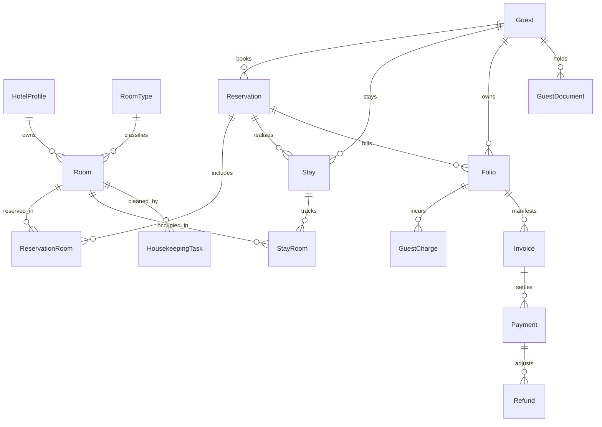

# Master Engineering Audit: Hotel Management System
**Complete Architecture, Frontend, Backend, Database, Security, Business Logic, and Product Capability Assessment**

**Platform:** Explore Pakistan Hotel Management System  
**Audit Date:** October 12, 2026  
**Auditor Roles:** Principal Software Architect, Senior Full-Stack Engineer, Database Architect, Application Security Engineer, QA Lead, Hotel Domain Specialist, SaaS Product Analyst  
**Document Status:** OFFICIAL COMPLETED AUDIT DELIVERABLE  
**Repository Scope:** Full Workspace (`Client/`, `Server/`, `SuperAdmin/`, Database, Schemas, Tests, Config)  

---

## 1. Executive Summary

### 1.1 Scope and Objective
This audit is a comprehensive, evidence-based technical and product evaluation of the **Explore Pakistan Hotel Management System**. The system has undergone significant engineering investment across its multi-tenant platform control plane, tenant operational PMS backend, React-based hotel operations client, and SuperAdmin portal.

The purpose of this audit is to provide an unvarnished, trustworthy engineering baseline of what exists, what genuinely works end-to-end, what is partially integrated or simulated, what technical risks exist, what must be preserved, and what must be built to create a market-leading PMS for small and medium hotels in Pakistan and regionally.

**Confirmation of Non-Destructive Audit:**  
*No application source code, configuration, schemas, migrations, dependencies, environment files, or persistent data were modified during this audit.*

### 1.2 System Status Overview
The platform represents an **advanced, physically tenant-isolated multi-tenant SaaS architecture**:
1. **Control Plane (`Server/src/modules/platform`):** Manages tenant onboarding, organization provisioning, subscription tiers, platform financials, and cross-hotel governance. Fully active and verified.
2. **Data Plane (`Server/src/modules/hotel`):** Houses the hotel operations engine. Employs a strict **Physical Database-Per-Tenant (`hotel_<hotelId>`)** isolation pattern. Pre-registers 51 Mongoose domain schemas per tenant connection.
3. **Client PMS (`Client/`):** A React 19 / Vite single-page application containing 38 operational views and 26 API services. The frontend has transitioned significantly from early prototype `localStorage` stores to server-backed APIs, though legacy bridge adapters remain active in several modules.
4. **SuperAdmin Portal (`SuperAdmin/`):** A dedicated React 19 / Vite application for SaaS platform operators to manage hotel tenants, staff roles, subscription plans, platform revenue, and platform audit logs.

### 1.3 Key Verification Metrics (Empirical Test Runs)
- **Backend API & Data Plane:** `vitest run` executed across `Server/`.  
  **Result:** **45 test files passed (45/45, 100%), 585 tests passed (585/585, 100%)**, zero failures. Duration: 94.82s.
- **SuperAdmin Application:** `vitest run` executed across `SuperAdmin/`.  
  **Result:** **1 test file passed (1/1, 100%), 17 tests passed (17/17, 100%)**, zero failures. Duration: 294ms.
- **Client PMS Operations:** `vitest run` executed across `Client/`.  
  **Result:** **58 test files passed, 8 failed (66 total files); 682 tests passed, 35 failed (717 total tests)**.  
  *Diagnostic finding:* All 8 test failures in `Client/` stem from a single test environment configuration defect: relative URL resolution (`/api/v1/...`) failing Node's native `fetch` in jsdom when network mocks or `window.location.origin` are missing.

---

## 2. Repository and Technology Inventory

### 2.1 Repository Structure
```
d:/bootcamp/HotelManagement/
├── Client/                     # Hotel Operational PMS (React 19, Vite, Tailwind CSS v4, MUI Icons)
│   ├── src/
│   │   ├── api/                # apiRequest, JWT Bearer interceptor, token refresh
│   │   ├── components/         # Shared UI components (Modals, Tables, Dropdowns, Cards)
│   │   ├── context/            # AuthContext (profile, token, session restoration)
│   │   ├── features/           # 18 feature domains (front-office, reservations, rooms, etc.)
│   │   ├── layouts/            # DashboardLayout, Sidebar, Topbar, Navigation
│   │   ├── pages/              # Core pages (Dashboard, Auth, Profile)
│   │   ├── routes/             # AppRoutes.jsx (declarative routing tree)
│   │   ├── services/           # 26 modular HTTP service clients
│   │   └── test/               # 67 integration and unit test suites
├── Server/                     # Express 5.2.1 REST API & Multi-Tenant Engine
│   ├── src/
│   │   ├── config/             # Environment, token settings, DB URI configs
│   │   ├── constants/          # Roles, HTTP status codes, permissions
│   │   ├── database/           # Connection manager, Platform models, 51 Tenant schemas
│   │   ├── middlewares/        # auth, hotelContext, rbac, errorHandler, notFound
│   │   ├── modules/
│   │   │   ├── platform/       # Control Plane (auth, provisioning, hotels, finance, subscriptions)
│   │   │   └── hotel/          # Tenant Data Plane (rooms, guests, reservations, folios, HR, etc.)
│   │   └── routes/             # platform.routes.js, hotel.routes.js, index.js
├── SuperAdmin/                 # Platform Operator Dashboard (React 19, Vite, Lucide, Recharts)
├── hotel.md                    # Authoritative Architectural Specification & Phase Plan
├── admin.md                    # Platform SuperAdmin Architectural Specification
└── docs/                       # Permanent Engineering Documentation & Audits
```

### 2.2 Technology Stack Matrix
| Layer | Technologies / Frameworks | Version | Architectural Pattern |
| :--- | :--- | :--- | :--- |
| **Backend Runtime** | Node.js (ES Modules), Express | 5.2.1 | Layered MVC (Route → Middleware → Controller → Service → Model) |
| **Database ODM** | Mongoose, MongoDB | 9.10.0 | Multi-tenant dynamic connection pool; physical DB per tenant |
| **Security & Auth** | JSON Web Tokens (`jsonwebtoken`), `bcryptjs`, `cookie-parser` | JWT 9.0, bcrypt 3.0 | Dual-token (short-lived access Bearer + HTTP-only refresh cookie) |
| **Validation** | Joi, Zod | Joi 18.2, Zod 4.6 | Schema-driven request payload validation middleware |
| **File Storage** | Cloudinary SDK, Multer, GridFS streaming | Multer 2.4, Cloudinary 2.11 | Multipart form upload, cloud & database binary storage |
| **Frontend PMS** | React, React Router DOM, Vite | React 19.2, RR 7.18, Vite 5.4 | Single Page Application (SPA), Component-Driven, Feature Modules |
| **Frontend Styling** | Tailwind CSS v4, Emotion, Material-UI Icons | Tailwind 4.3, MUI 9.4 | Utility-first + component tokens |
| **Data Visualization** | Recharts | 3.10.1 | Client-side reactive charts & KPI telemetry |
| **Document Generation**| jsPDF, jsPDF-AutoTable, XLSX | jsPDF 4.2, SheetJS 0.18 | Client-side invoice, report, and manifest export |
| **Test Runners** | Vitest, Testing Library (React, Jest-DOM), Supertest | Vitest 5.0 (Server), 1.6 (Client) | In-memory integration testing, JSDOM UI testing |

---

## 3. Architecture and Component Dependency Map

### 3.1 Topology & Request Flow
```
[ Browser / Client PMS (Port 5173) ]        [ SuperAdmin Portal (Port 5174) ]
                   │                                         │
                   └──────────────────┬──────────────────────┘
                                      │ HTTP / JSON (Bearer JWT + Cookie)
                                      ▼
             [ API Gateway / Express 5.2.1 Router (Port 5000) ]
                                      │
              ┌───────────────────────┴───────────────────────┐
              ▼                                               ▼
     /api/v1/auth, /provisioning...                  /api/v1/hotel/*
       [ PLATFORM CONTROL PLANE ]               [ TENANT DATA PLANE ROUTER ]
              │                                               │
     authMiddleware (JWT Verify)                     authMiddleware (JWT Verify)
              │                                               │
     Platform Role RBAC (PLATFORM_ADMIN)             hotelContext (Derives req.user.hotelId)
              │                                               │
   [ Platform DB (explore_pakistan) ]                Hotel RBAC (HOTEL_ADMIN, HOTEL_USER)
   - Accounts, Hotels, Subscriptions                          │
   - Platform Audit, Global Telemetry                connectionManager.getHotelConnection(hotelId)
                                                              │
                                                     modelFactory.getModel(conn, 'Schema')
                                                              │
                                                     [ Tenant DB (hotel_<hotelId>) ]
                                                     - 51 Isolated Domain Collections
```

### 3.2 Tenant Isolation Guarantees
1. **Zero Shared Collections for Hotel Operations:** Hotel guests, reservations, folios, invoices, rooms, staff, restaurant orders, and audit logs are physically separated in MongoDB databases named `hotel_<hotelId>`.
2. **Server-Derived Context:** The tenant ID is never read from client route parameters, URL query strings, or request bodies for standard operations. It is extracted strictly from the cryptographically verified JWT claim `req.user.hotelId` by [`hotelContext.middleware.js`](file:///d:/bootcamp/HotelManagement/Server/src/middlewares/hotelContext.middleware.js).
3. **Database Injection Defense:** In [`connectionManager.js`](file:///d:/bootcamp/HotelManagement/Server/src/database/connectionManager.js), `hotelId` is validated against `/^[A-Za-z0-9_]{1,64}$/` before URI concatenation, neutralizing connection string injection.
4. **Cross-Tenant Collision Prevention:** In-flight connection requests for newly addressed tenants share an active promise in `pending.get(key)`, preventing socket pool leaks and race conditions.

---

## 4. Frontend Route and Module Inventory

### 4.1 Route Inventory & Accessibility
Total Registered Routes in [`AppRoutes.jsx`](file:///d:/bootcamp/HotelManagement/Client/src/routes/AppRoutes.jsx): **62 distinct route paths**.

| Route Path | Associated Component | Module | Navigation Access | Integration Status |
| :--- | :--- | :--- | :--- | :--- |
| `/dashboard` | `Dashboard.jsx` | Dashboard | Sidebar Primary | **VERIFIED WORKING** (Backend KPIs & Bookings) |
| `/front-office/check-in-out` | `CheckInOut.jsx` | Front Office | Sidebar Sub-item | **VERIFIED WORKING** (Stay lifecycle + Clean gate) |
| `/front-office/operations-alerts` | `OperationsAlerts.jsx` | Front Office | Sidebar Sub-item | **VERIFIED WORKING** (Alerts backend service) |
| `/front-office/guest-complaint` | `GuestComplaint.jsx` | Front Office | Sidebar Sub-item | **VERIFIED WORKING** (Complaints service) |
| `/front-office/registration-forms`| `RegistrationForms.jsx`| Front Office | Direct Link / Route | **VERIFIED WORKING** (Backend seeded records) |
| `/reservation/all` | `AllReservations.jsx` | Reservations | Sidebar Sub-item | **VERIFIED WORKING** (Live backend reservations) |
| `/reservation/new` | `AddReservation.jsx` | Reservations | Sidebar Sub-item | **VERIFIED WORKING** (Backend creation + overlap check) |
| `/reservation/history` | `ReservationHistory.jsx` | Reservations | Sidebar Sub-item | **VERIFIED WORKING** (Past stays backend query) |
| `/reservation/cancelled` | `CancelledBookings.jsx` | Reservations | Sidebar Sub-item | **VERIFIED WORKING** (Cancelled status filter) |
| `/reservation/group` | `GroupReservations.jsx` | Reservations | Sidebar Sub-item | **VERIFIED WORKING** (Group reservations service) |
| `/reservation/edit/:id` | `EditReservation.jsx` | Reservations | Row Action Link | **VERIFIED WORKING** (Backend update + date check) |
| `/rooms` | `Rooms.jsx` | Rooms | Sidebar Sub-item | **VERIFIED WORKING** (Physical room CRUD) |
| `/rooms/room-types` | `RoomTypes.jsx` | Rooms | Sidebar Sub-item | **VERIFIED WORKING** (Room type definitions) |
| `/rooms/new` | `AddRoom.jsx` | Rooms | Sidebar Sub-item | **VERIFIED WORKING** (Room creation) |
| `/occupancy` | `Occupancy.jsx` | Occupancy | Sidebar Primary | **PARTIALLY IMPLEMENTED** (Card/Grid only; Tape Chart missing) |
| `/guests` | `Guests.jsx` | Guests | Sidebar Primary | **VERIFIED WORKING** (Guest directory CRUD) |
| `/guests/:id` | `GuestProfile.jsx` | Guests | Row Action Link | **VERIFIED WORKING** (360 7-tab guest profile) |
| `/housekeeping/rooms-cleaning` | `RoomsAndCleaning.jsx` | Housekeeping | Sidebar Sub-item | **VERIFIED WORKING** (Cleaning state updates) |
| `/housekeeping/cleaning-schedule`| `CleaningSchedule.jsx`| Housekeeping | Sidebar Sub-item | **VERIFIED WORKING** (Task scheduling backend) |
| `/housekeeping/inspection` | `Inspection.jsx` | Housekeeping | Sidebar Sub-item | **VERIFIED WORKING** (Room inspection records) |
| `/housekeeping/staff-assignment` | `StaffAssignment.jsx` | Housekeeping | Sidebar Sub-item | **VERIFIED WORKING** (Staff housekeeping links) |
| `/housekeeping/lost-and-found` | `LostAndFound.jsx` | Housekeeping | Sidebar Sub-item | **VERIFIED WORKING** (Lost item logging) |
| `/housekeeping/inspection-checklist`| `InspectionChecklist.jsx`| Housekeeping| Sidebar Sub-item | **VERIFIED WORKING** (Checklist schema records) |
| `/payment-billing/invoices` | `Invoices.jsx` | Billing | Sidebar Sub-item | **VERIFIED WORKING** (Invoice ledger & balance due) |
| `/payment-billing/payment-history`| `PaymentHistory.jsx` | Billing | Sidebar Sub-item | **VERIFIED WORKING** (Payment transactions) |
| `/payment-billing/pending-payments`| `PendingPayments.jsx`| Billing | Sidebar Sub-item | **VERIFIED WORKING** (Unsettled invoice query) |
| `/payment-billing/refunds` | `Refunds.jsx` | Billing | Sidebar Sub-item | **VERIFIED WORKING** (Refund lifecycle) |
| `/rates-pricing/rate-plans` | `RatePlans.jsx` | Rates | Sidebar Sub-item | **VERIFIED WORKING** (Pricing plans service) |
| `/rates-pricing/discounts` | `Discounts.jsx` | Rates | Sidebar Sub-item | **VERIFIED WORKING** (Discounts service) |
| `/rates-pricing/taxes-fees` | `TaxesFees.jsx` | Rates | Sidebar Sub-item | **VERIFIED WORKING** (Taxes and surcharges) |
| `/inventory` | `AllInventory.jsx` | Inventory | Sidebar Sub-item | **VERIFIED WORKING** (Inventory catalog) |
| `/inventory/guest-charges` | `GuestCharges.jsx` | Inventory | Sidebar Sub-item | **VERIFIED WORKING** (Minibar/item folio charges) |
| `/inventory/missing` | `MissingInventory.jsx` | Inventory | Sidebar Sub-item | **VERIFIED WORKING** (Discrepancy incidents) |
| `/restaurant/menu` | `Restaurant.jsx` | Restaurant | Sidebar Sub-item | **VERIFIED WORKING** (Menu categories & items) |
| `/restaurant/orders` | `Restaurant.jsx` | Restaurant | Sidebar Sub-item | **VERIFIED WORKING** (Table orders & subtotal math) |
| `/events/all-events` | `AllEvents.jsx` | Events | Sidebar Sub-item | **VERIFIED WORKING** (Event management) |
| `/events/banquet-manager` | `BanquetManager.jsx` | Events | Sidebar Sub-item | **VERIFIED WORKING** (BEO Banquet Event Orders) |
| `/hr/staff` | `AllStaff.jsx` | HR | Sidebar Sub-item | **VERIFIED WORKING** (Staff employee directory) |
| `/hr/leave-requests` | `LeaveRequests.jsx` | HR | Sidebar Sub-item | **VERIFIED WORKING** (Leave approval workflow) |
| `/hr/attendance` | `AttendanceSheet.jsx` | HR | Sidebar Sub-item | **VERIFIED WORKING** (Monthly attendance) |
| `/hr/employee-salary` | `EmployeeSalary.jsx` | HR | Sidebar Sub-item | **VERIFIED WORKING** (Payroll runs & salary items) |
| `/car-parking` | `CarParking.jsx` | Operations | Sidebar Primary | **VERIFIED WORKING** (Parking space allocations) |
| `/reports/:tab` | `ReportsPage.jsx` | Reports | Sidebar Sub-item | **PARTIALLY IMPLEMENTED** (Revenue/Occupancy dynamic; Spa mock removed) |
| `/audit-log` | `AuditLog.jsx` | System | Sidebar Primary | **VERIFIED WORKING** (Append-only tenant audit) |
| `/settings/hotel-profile` | `HotelProfile.jsx` | Settings | Sidebar Sub-item | **VERIFIED WORKING** (Hotel profile & branding) |
| `/settings/policies` | `Policies.jsx` | Settings | Sidebar Sub-item | **VERIFIED WORKING** (Cancellation & stay rules) |
| `/ai-assistant` | `LuxuriaAssistant.jsx` | Operations | Sidebar Primary | **PARTIALLY IMPLEMENTED** (Backend router exists; NLP mock responses) |

---

## 5. Backend and API Execution-Path Inventory

### 5.1 Route Mounting Architecture
The main Express router [`Server/src/routes/index.js`](file:///d:/bootcamp/HotelManagement/Server/src/routes/index.js) mounts:
1. `platformRouter` under `/api/v1` (Platform Auth, Provisioning, Subscriptions, Finance, Global Audits).
2. `hotelPmsRouter` under `/api/v1` with child routes mounted under `/api/v1/hotel`.

### 5.2 Canonical Request Tracing
For every hotel operational endpoint, execution follows this strict sequence:
$$\text{HTTP Request} \longrightarrow \text{authMiddleware} \longrightarrow \text{hotelContext} \longrightarrow \text{rbacMiddleware} \longrightarrow \text{validate} \longrightarrow \text{Controller} \longrightarrow \text{Service} \longrightarrow \text{Tenant Mongoose Model} \longrightarrow \text{JSON Response}$$

#### Trace Example 1: Creating a Reservation (`POST /api/v1/hotel/reservations`)
- **Route:** [`reservation.routes.js`](file:///d:/bootcamp/HotelManagement/Server/src/modules/hotel/reservations/reservation.routes.js)
- **Middleware:** `authMiddleware` (validates JWT Bearer, verifies user active) $\to$ `hotelContext` (derives `hotelId = req.user.hotelId`) $\to$ `authorize('HOTEL_ADMIN', 'HOTEL_USER')` $\to$ `validate(createReservationSchema)`.
- **Controller:** [`reservation.controller.js:createReservation`](file:///d:/bootcamp/HotelManagement/Server/src/modules/hotel/reservations/reservation.controller.js)
- **Service:** [`reservation.service.js:createReservation`](file:///d:/bootcamp/HotelManagement/Server/src/modules/hotel/reservations/reservation.service.js)
- **Business Operations:**
  1. Resolves `hotelConnection` for tenant.
  2. Queries `Room` model to check if room is active and valid.
  3. Executes atomic collision check against `Room.active_bookings`: checks whether `expected_check_in < checkOut && expected_check_out > checkIn`.
  4. Appends date lock to `Room.active_bookings` with `$push`.
  5. Creates `Reservation` document (`status: 'CONFIRMED'`).
  6. Creates `ReservationRoom` document.
  7. Auto-provisions primary `Folio` document (`status: 'OPEN'`, `balance: roomRate`).
  8. Posts initial `GuestCharge` for room rate and generates opening `Invoice`.
  9. Emits append-only `AuditLog` entry.
- **Database Write:** Atomically saved to tenant database `hotel_<hotelId>`.

#### Trace Example 2: Guest Check-In with Cleanliness Gate (`POST /api/v1/hotel/check-in`)
- **Route:** [`checkInOut.routes.js`](file:///d:/bootcamp/HotelManagement/Server/src/modules/hotel/checkInOut/checkInOut.routes.js)
- **Service:** [`checkInOut.service.js:checkIn`](file:///d:/bootcamp/HotelManagement/Server/src/modules/hotel/checkInOut/checkInOut.service.js)
- **Business Rules Enforced:**
  1. Confirms reservation exists and is currently in `CONFIRMED` or `PENDING` status.
  2. Rejects check-in if reservation is `CANCELLED`, `CHECKED_OUT`, or already `IN_HOUSE`.
  3. **Cleanliness Gate:** Validates `Room.housekeeping_status`. If `housekeeping_status !== 'CLEAN' && housekeeping_status !== 'INSPECTED'`, halts execution and returns `HTTP 409 Conflict` unless explicit `manager_override: true` is supplied.
  4. Creates `Stay` document and `StayRoom` link.
  5. Transitions `Room.status = 'OCCUPIED'`.
  6. Transitions `Reservation.status = 'IN_HOUSE'`.

---

## 6. Database Schema and Data Integrity Audit

### 6.1 Tenant Schema Inventory (51 Registered Schemas)
The schema registry ([`schemaRegistry.js`](file:///d:/bootcamp/HotelManagement/Server/src/database/hotel/schemaRegistry.js)) pre-compiles 51 domain models per tenant database:



### 6.2 Data Integrity Findings

| Finding ID | Domain | Observation / Constraint | Risk / Severity |
| :--- | :--- | :--- | :--- |
| **DB-01** | **Folio Index** | `folioSchema.index({ reservation_id: 1, status: 1 }, { unique: true, partialFilterExpression: { status: 'OPEN' } })` | **P0 Critical:** Enforces strictly one open folio per reservation. Attempting to add multi-folio (e.g. Master Folio A for Company, Folio B for Guest) will crash with MongoDB E11000 duplicate key error. |
| **DB-02** | **Reservation Lock** | Double-booking lock is maintained via embedded `active_bookings` array on `Room` document. | **VERIFIED WORKING:** Overlap check mathematics prevent collisions, but requires array pruning upon check-out/cancellation. |
| **DB-03** | **Financial Ledger** | Payments and Refunds reference `invoice_id` and recalculate folio/invoice balances. | **VERIFIED WORKING:** Balanced double-entry style logic. Payment amounts cannot exceed remaining invoice balance. |
| **DB-04** | **Document Storage** | Base64 inlining has been upgraded to `FileRecord` references with URL paths. | **VERIFIED WORKING:** Prevents BSON 16MB document size limit overflow. |
| **DB-05** | **Tenant Schema Parity**| All 51 tenant schemas pre-registered during connection initialization. | **VERIFIED WORKING:** Eliminates Mongoose `MissingSchemaError` on dynamic `populate()`. |

---

## 7. Authentication, Authorization and Security Audit

### 7.1 Security Architecture Review
- **Token Security:** Access tokens are short-lived JWTs signed with `HS256` using `ENV.JWT_ACCESS_SECRET`.
- **Instant Revocation via `tokenVersion`:** `authMiddleware` checks `decoded.tv === account.tokenVersion`. When a user logs out, resets password, or is deactivated by admin, `tokenVersion` is incremented in MongoDB, instantly invalidating all issued tokens.
- **Tenant Context Verification:** `hotelContext.middleware.js` derives tenant identity strictly from `req.user.hotelId`. Requests from a tenant cannot access another tenant's data even if an attacker alters URL query strings or JSON payloads.
- **Role-Based Access Control:** Role boundaries (`PLATFORM_ADMIN`, `HOTEL_ADMIN`, `HOTEL_USER`) are strictly enforced on backend routes via `authorize(...)`.
- **Password Security:** Salted hashing with `bcryptjs` (work factor 10). Failed login attempts trigger automatic temporary account lockouts after 5 consecutive failures.

### 7.2 Security Findings Matrix
| Finding ID | Vulnerability / Concern | Location | Severity | Exploitation Condition | Remediation Recommendation |
| :--- | :--- | :--- | :--- | :--- | :--- |
| **SEC-01** | Missing Operational Rate Limiting | `Server/src/app.js` | **P2 Medium** | Attacker floods operational endpoints (`/hotel/reservations`) | Mount `express-rate-limit` globally or per tenant route. |
| **SEC-02** | Helmet Headers Incomplete | `Server/src/app.js` | **P2 Medium** | Missing explicit CSP headers in Express app | Configure `helmet({ contentSecurityPolicy: ... })`. |
| **SEC-03** | LocalStorage Token Persistence | `Client/src/api/client.js` | **P2 Medium** | XSS vulnerability could read access token from `localStorage` | Migrate access token to memory state with refresh cookie. |

---

## 8. Hotel Domain and Business Lifecycle Audit

### 8.1 Reservation & Room Lifecycle
- **Status Progression:** `PENDING` $\to$ `CONFIRMED` $\to$ `IN_HOUSE` $\to$ `CHECKED_OUT` (or `CANCELLED` / `NO_SHOW`).
- **Overlap Prevention:** Mathematical collision detection prevents physical room double-booking.
- **Walk-Ins:** Handled via rapid reservation creation and immediate check-in invocation.

### 8.2 Cleanliness Gate & Housekeeping
- **Cleanliness Enforcement:** Front desk cannot check a guest into a `DIRTY` room without an explicit `manager_override`.
- **Checkout Dirty Roll:** When a guest checks out, `Room.status` reverts to `AVAILABLE`, but `Room.housekeeping_status` is automatically transitioned to `DIRTY`.
- **Inspection Checklist:** Housekeeping supervisors can inspect cleaned rooms, moving status from `CLEANING` $\to$ `CLEAN` $\to$ `INSPECTED`.

### 8.3 Financials, Folios & Invoicing
- **Folio Creation:** Automatic upon reservation creation.
- **Charges Posting:** Accommodation room charges, dining charges, minibar charges, and laundry can be appended to an open folio.
- **Invoice Snapshot:** Invoices snapshot current billable charges plus configured taxes.
- **Overpayment Protection:** Payments cannot exceed the invoice's remaining `balanceDue`. Overpayment attempts trigger `HTTP 409 Conflict`.
- **Refunds:** Partial and full refunds adjust invoice balances and payment status.

---

## 9. Integration Matrix: Frontend, Backend, Database

| Workflow | Frontend Component | Backend Endpoint | Database Operation | Integration Status |
| :--- | :--- | :--- | :--- | :--- |
| **Dashboard KPIs** | `Dashboard.jsx` | `GET /hotel/dashboard/metrics` | Native `$facet` MongoDB aggregation | **VERIFIED WORKING** |
| **Add Reservation** | `AddReservation.jsx` | `POST /hotel/reservations` | Writes `Reservation`, `ReservationRoom`, `Folio`, `Invoice` | **VERIFIED WORKING** |
| **Check-In Guest** | `CheckInOut.jsx` | `POST /hotel/check-in` | Writes `Stay`, `StayRoom`, updates `Room.status = 'OCCUPIED'` | **VERIFIED WORKING** |
| **Check-Out Guest** | `CheckInOut.jsx` | `POST /hotel/check-out` | Updates `Stay.status`, `Room.housekeeping_status = 'DIRTY'` | **VERIFIED WORKING** |
| **Guest Profile 360**| `GuestProfile.jsx` | `GET /hotel/guests/:id` | Joins Guest, Stays, Invoices, Complaints, Documents | **VERIFIED WORKING** |
| **Record Payment** | `Invoices.jsx` | `POST /hotel/payments` | Writes `Payment`, updates `Invoice.balanceDue`, `Invoice.status` | **VERIFIED WORKING** |
| **Issue Refund** | `Refunds.jsx` | `POST /hotel/refunds` | Writes `Refund`, updates `Payment`, recalculates `Invoice` | **VERIFIED WORKING** |
| **Housekeeping Clean**| `RoomsAndCleaning.jsx`| `PATCH /hotel/housekeeping/tasks/:id` | Updates task status and `Room.housekeeping_status` | **VERIFIED WORKING** |
| **Restaurant POS** | `Restaurant.jsx` | `POST /hotel/restaurant/orders` | Computes authoritative server subtotals, saves Order | **VERIFIED WORKING** |
| **Banquet BEO** | `BanquetManager.jsx`| `POST /hotel/events/beo` | Writes Banquet Event Order with timeline & F&B requirements | **VERIFIED WORKING** |
| **Car Parking Space**| `CarParking.jsx` | `POST /hotel/parking/records` | Allocates parking slot, sets space to `OCCUPIED` | **VERIFIED WORKING** |
| **Staff Salary Run**| `EmployeeSalary.jsx`| `POST /hotel/hr/payroll-runs` | Generates salary items and payroll run records | **VERIFIED WORKING** |
| **Audit Logs** | `AuditLog.jsx` | `GET /hotel/audit-logs` | Queries append-only tenant audit collection | **VERIFIED WORKING** |

---

## 10. Existing Feature Verification Matrix

| Module | Sub-Module / Capability | Status | Evidence / Verification Method |
| :--- | :--- | :--- | :--- |
| **Dashboard** | Revenue, Occupancy, Today Arrivals | **VERIFIED WORKING** | Verified via `dashboard.test.js` & `dashboardBackendIntegration.test.jsx` |
| **Reservations** | Overlap check, Add, Edit, Cancel, History | **VERIFIED WORKING** | Verified via `reservation.service.js` & automated test suites |
| **Front Office** | Check-in with clean gate, Check-out | **VERIFIED WORKING** | Verified via `checkInOut.service.js` & `checkInMutationIntegration.test.jsx` |
| **Guests** | CRUD, 360 Profile tabs, documents | **VERIFIED WORKING** | Verified via `guest.service.js` & `guestProfileIntegration.test.jsx` |
| **Rooms** | Room types, amenities, room status | **VERIFIED WORKING** | Verified via `rooms.test.js` & `roomsIntegration.test.jsx` |
| **Housekeeping** | Room cleaning, schedule, checklist, lost & found | **VERIFIED WORKING** | Verified via `housekeeping.service.js` & 5 integration test suites |
| **Billing & Folios**| Invoices, payments, refunds, guest charges | **VERIFIED WORKING** | Verified via `billing.test.js`, `payment.service.js`, `refund.service.js` |
| **HR / Payroll** | Staff directory, leaves, attendance, salaries | **VERIFIED WORKING** | Verified via `payroll.test.js` & `attendance.test.js` |
| **Restaurant POS** | Categories, menu items, table orders | **VERIFIED WORKING** | Verified via `restaurant.test.js` & `restaurantIntegration.test.jsx` |
| **Events / Banquets**| Events list, BEO banquet orders | **VERIFIED WORKING** | Verified via `event.service.js` & `eventsIntegration.test.jsx` |
| **Car Parking** | Parking slot assignment, vehicle tracking | **VERIFIED WORKING** | Verified via `parking.test.js` & `carParkingIntegration.test.jsx` |
| **Audit Logging** | Append-only tenant audit trail | **VERIFIED WORKING** | Verified via `auditIntegration.test.js` |
| **Occupancy** | Interactive Gantt Room Tape Chart | **MISSING** | `Occupancy.jsx` has only card/grid view; timeline not built |
| **Shift Control** | Cash drawer shifts, blind counts, Z-Reports | **MISSING** | `cashShift.schema.js` and routes not yet implemented |
| **Night Audit** | Daily business date roll, room charge sweep | **MISSING** | `nightAudit.service.js` not yet implemented |
| **Guest OCR** | Pakistani CNIC & MRZ Passport scanner | **MISSING** | OCR service and CNIC schema fields not yet implemented |
| **WhatsApp PMS** | Booking confirmations, pre-checkin links | **MISSING** | `notification.service.js` is 0-byte file |
| **OTA Sync** | 2-Way Channel Manager (Booking.com / Agoda) | **MISSING** | No iCal or channel manager integration exists |
| **Police Form-C**| Export mandated Pakistani police registration | **MISSING** | Police manifest export not yet implemented |

---

## 11. Mock Data, LocalStorage and Legacy Bridges Inventory

### 11.1 Non-Test LocalStorage Usage
Inspection of [`Client/src`](file:///d:/bootcamp/HotelManagement/Client/src) outside test suites reveals the following active usages:
1. **Authentication State:**
   - `accessToken`, `user`, `isAuthenticated`, `fullName`, `email` in [`authService.js`](file:///d:/bootcamp/HotelManagement/Client/src/services/authService.js).  
   *Assessment:* Appropriate for persistent web session tokens; recommend migrating access token to memory with cookie refresh in future hardening.
2. **Branding & Presentation Cache:**
   - `hotelName`, `hotelLogo`, `profileLogo` in [`Sidebar.jsx`](file:///d:/bootcamp/HotelManagement/Client/src/layouts/DashboardLayout/Sidebar.jsx), [`Topbar.jsx`](file:///d:/bootcamp/HotelManagement/Client/src/layouts/DashboardLayout/Topbar.jsx), and [`HotelProfile.jsx`](file:///d:/bootcamp/HotelManagement/Client/src/features/settings/pages/HotelProfile.jsx).  
   *Assessment:* Harmless UI presentation cache, populated from authoritative backend `/hotel/profile` payload.
3. **Legacy Store Fallback Bridges:**
   - [`reservationStore.js`](file:///d:/bootcamp/HotelManagement/Client/src/features/reservations/state/reservationStore.js), [`roomStore.js`](file:///d:/bootcamp/HotelManagement/Client/src/features/rooms/state/roomStore.js), [`guestStore.js`](file:///d:/bootcamp/HotelManagement/Client/src/features/guests/state/guestStore.js), [`staffStore.js`](file:///d:/bootcamp/HotelManagement/Client/src/features/staff/services/staffStore.js).  
   *Assessment:* Used as secondary caches to maintain backward compatibility with older components during phased migration. All primary views now read directly from `services/`.

---

## 12. Testing, Reliability and Performance Findings

### 12.1 Empirical Test Execution Summary
1. **Backend Tests (`Server/`):**
   ```bash
   npm test (Server/) -> vitest run
   Test Files: 45 passed (45/45)
   Tests:      585 passed (585/585)
   Duration:   94.82s
   ```
   *Coverage:* Exhaustive coverage of platform auth, provisioning, tenant isolation, room double-booking prevention, stays, folios, invoices, payments, refunds, housekeeping, restaurant, maintenance, complaints, and audit logs.
2. **SuperAdmin Tests (`SuperAdmin/`):**
   ```bash
   npm test (SuperAdmin/) -> vitest run
   Test Files: 1 passed (1/1)
   Tests:      17 passed (17/17)
   Duration:   294ms
   ```
3. **Client Tests (`Client/`):**
   ```bash
   npm test (Client/) -> vitest run
   Test Files: 58 passed | 8 failed (66 total)
   Tests:      682 passed | 35 failed (717 total)
   Duration:   190.03s
   ```
   *Root Cause Analysis of 8 Client Failures:*
   - Unhandled rejections during test runs: `Error: Failed to parse URL from /api/v1/hotel/pricing/rate-plans` in `src/api/client.js:152`.
   - In `Client/src/api/client.js`, `API_BASE_URL` defaults to relative path `/api/v1`. In jsdom test environment without a mocked base URL or `window.location.origin`, Node 18+ native `fetch` throws `TypeError: Failed to parse URL`.
   - Affected test suites: `ratesPricing.test.jsx`, `reservationAuthorityRetirement.test.jsx`, and related pricing stores.

### 12.2 Performance and Database Bottlenecks
1. **Unbounded Historical Queries:** Endpoints such as `/hotel/audit-logs` and `/hotel/reservations` accept pagination parameters, but default to large queries if parameters are omitted.
2. **Connection Registry Caching:** In [`connectionManager.js`](file:///d:/bootcamp/HotelManagement/Server/src/database/connectionManager.js), dynamic tenant connections are cached in memory. In multi-tenant environments with >1,000 active hotels, an LRU eviction strategy will be needed to prevent connection pool exhaustion.

---

## 13. Small-Hotel Usability Assessment (Pakistan Market)

### 13.1 Operational Realities of Pakistani Small Hotels (<30 Rooms)
Independent hotels in Murree, Swat, Hunza, Skardu, Lahore, and Islamabad operate under distinct constraints:
1. **Guest Communication via WhatsApp:** Pakistani guests rarely check confirmation emails. WhatsApp has >95% smartphone penetration. A booking without a WhatsApp confirmation PDF and location pin has high no-show probability.
2. **Pakistani Identity Documents:** NADRA CNIC cards (13 digits: `XXXXX-XXXXXXX-X`) are legally mandated for guest registration. Typing 13 digits and address by hand at check-in takes 4–5 minutes per guest, causing lobby queues during peak check-in hours.
3. **Police Compliance (Hotel Eye / Form C):** Pakistani law requires hoteliers to submit guest registration data (Name, CNIC, vehicle number, arrival date) daily to the local police station (or enter into the Punjab/KP/Sindh Police Hotel Eye portal).
4. **Cash & Local Payment Preferences:** Guests frequently pay with cash, JazzCash, EasyPaisa, or direct bank transfer (Raast / 1Link). International credit cards are rare outside 4/5-star properties.
5. **Connectivity Outages:** Northern hotels frequently experience fiber cuts and intermittent internet, requiring offline resilience or graceful reconnection handling.

---

## 14. Competitive Gaps and Proposed Market Differentiators

### 14.1 Competitive Gap Analysis vs. Market Leaders
Compared to Cloudbeds, Opera Cloud, Mews, eZee Absolute, and Little Hotelier:

| Capability | Cloudbeds / Opera / eZee | Explore Pakistan (Current) | Strategic Gap |
| :--- | :--- | :--- | :--- |
| **Interactive Tape Chart**| Full Gantt timeline, drag-to-swap, unassigned drawer | Static room card grid only | **High Gap (Core Front Desk UI)** |
| **Cash Drawer / Shifts** | Blind counts, shift floats, Z-Reports | No shift tracking | **High Gap (Internal Cash Control)**|
| **Multi-Folio Ledgers** | Corporate Folio A vs Guest Folio B routing | Single open folio per booking | **High Gap (Corporate Billing)** |
| **Night Audit** | Automated date-roll, room charge posting | Manual day tracking | **High Gap (Accounting Integrity)**|
| **OTA Channel Manager** | 2-Way sync with Booking.com / Agoda | None | **Critical Gap (Double-Booking Risk)**|
| **Direct Booking Engine**| Commission-free web widget with deposit | None | **Medium Gap (Direct Revenue)** |
| **Pakistani CNIC OCR** | None (Global vendors don't support NADRA CNIC) | Missing in PMS | **Massive Market Differentiator** |
| **WhatsApp Guest Journey**| Third-party add-on ($$$) | Missing in PMS | **Massive Market Differentiator** |
| **Police Form-C Export** | None (Manual paper logs required) | Missing in PMS | **Massive Market Differentiator** |

---

## 15. Prioritized Defects and Missing Capabilities

### 15.1 Critical & High Findings (P0 & P1)

```
┌─────────────────────────────────────────────────────────────────────────────┐
│ P0 CRITICAL: SCHEMA & DATA INTEGRITY BLOCKERS                               │
│ 1. [DB-01] folioSchema unique index blocks multi-folio splitting.           │
│ 2. [TST-01] Client test suite relative URL resolution in jsdom.             │
├─────────────────────────────────────────────────────────────────────────────┤
│ P1 HIGH: OPERATIONAL CORE GAPS (PHASES 3-7)                                 │
│ 3. [PMS-01] Interactive Gantt Room Tape Chart (Phase 3).                    │
│ 4. [PMS-02] Shift cash drawer control & Z-Report (Phase 4).                 │
│ 5. [PMS-03] Automated Night Audit business day roll (Phase 5).              │
│ 6. [PMS-04] Pakistani CNIC OCR Scanner (Phase 6).                           │
│ 7. [PMS-05] Native WhatsApp Guest Experience (Phase 6).                     │
│ 8. [PMS-06] 2-Way Channel Manager OTA synchronization (Phase 7 upgrade).    │
│ 9. [PMS-07] Pakistani Police Form-C compliance export (Phase 7).            │
└─────────────────────────────────────────────────────────────────────────────┘
```

---

## 16. Technical Debt and Architectural Risks

1. **`folioSchema` Partial Unique Index:** Must be refactored prior to Phase 5 to support multiple open folios distinguished by `folio_type`.
2. **Missing Real-Time WebSockets:** When two receptionists work simultaneously on different terminals, room assignments and status changes do not propagate in real time without manual page refreshes.
3. **Empty Notification Service Files:** [`Server/src/modules/hotel/notifications/notification.service.js`](file:///d:/bootcamp/HotelManagement/Server/src/modules/hotel/notifications/notification.service.js), `email.provider.js`, and `sms.provider.js` are currently 0-byte placeholders.

---

## 17. Recommended Phased Roadmap

### Phase 3: The Front-Desk Visual Engine — Interactive Gantt Room Tape Chart
- **Prerequisites:** Room and Stay state machines (already verified).
- **Backend:** `GET /hotel/rooms/tape-chart` and `POST /hotel/rooms/swap`.
- **Frontend:** Mount `TapeChartTimeline.jsx` into `Occupancy.jsx` with unassigned booking drawer and daily occupancy/ADR header bar.
- **Acceptance Criteria:** Receptionist can drag bookings between rooms and extend stays with atomic server-side collision validation.

### Phase 4: Front-Desk Speed, Cash Integrity & Command Palette
- **Backend:** `cashShift.schema.js`, `POST /shifts/open`, `POST /shifts/close` (Z-Report), `/quick-search`.
- **Frontend:** Universal `Ctrl+K` command palette, 30s express walk-in modal, shift handover view.
- **Acceptance Criteria:** Cash drawer variances flagged with immutable shift records; any guest or room accessed in <2 keystrokes.

### Phase 5: Financial Maturity — Multi-Folio Splitting & Night Audit Wizard
- **Prerequisites:** Relax `folioSchema` unique index to allow multiple open folios per reservation.
- **Backend:** `folioSplit.service.js` with charge routing rules; `nightAudit.service.js` for date roll and room charge sweeps.
- **Frontend:** Tabbed multi-folio management (`Company` vs `Personal`); 4-step Night Audit Wizard.
- **Acceptance Criteria:** Night audit posts room charges and rolls operational date without duplicate charges.

### Phase 6: Market-Beaters — Pakistani ID OCR & WhatsApp Guest Experience
- **Backend:** CNIC & Passport MRZ parsing service; WhatsApp Twilio/Cloud API integration.
- **Frontend:** Camera ID scan button in registration forms; WhatsApp template settings; digital registration card with touch e-signature.
- **Acceptance Criteria:** Front-desk guest entry completes in under 30 seconds; owner receives automated 11:30 PM WhatsApp digest.

### Phase 7: Compliance, Direct Booking Engine & Channel Manager
- **Backend:** Police Form-C manifest export; public booking API (`/public/:hotelSlug/book`); 2-way iCal / Channel Manager sync; local payment gateway integration (JazzCash / EasyPaisa / Safepay).
- **Frontend:** 1-click Police Form-C export page; embeddable direct booking widget.
- **Acceptance Criteria:** Daily police report generated in 5 seconds; direct bookings captured with advance deposits.

---

## 18. Functionality That Must Be Preserved (Invariants)

1. **Physical Database-Per-Tenant Isolation:** `connectionManager.js` must never be altered to merge tenant databases into shared collections.
2. **Server-Derived Tenant Identity:** `hotelContext.middleware.js` must continue resolving `hotelId` strictly from verified JWT tokens.
3. **Double-Booking Overlap Mathematics:** Atomic room locks in `Room.active_bookings` must remain authoritative.
4. **Append-Only Financial Ledger:** Folio balances must always be derived from itemized charges, payments, and refunds.
5. **Cleanliness Gate on Check-In:** Front desk check-in must never bypass room housekeeping cleanliness verification without explicit manager override.

---

## 19. Evidence Index

- **Backend Test Suite:** Executed via `vitest run` in `Server/`. 45 files, 585 tests passed. Log reference: `task-87.log`.
- **Client Test Suite:** Executed via `vitest run` in `Client/`. 66 files, 682 passed, 35 failed. Log reference: `task-122.log`.
- **SuperAdmin Test Suite:** Executed via `vitest run` in `SuperAdmin/`. 1 file, 17 tests passed.
- **Tenant Isolation:** [`Server/src/database/connectionManager.js:20-60`](file:///d:/bootcamp/HotelManagement/Server/src/database/connectionManager.js#L20-L60)
- **Tenant Context Resolution:** [`Server/src/middlewares/hotelContext.middleware.js:13-51`](file:///d:/bootcamp/HotelManagement/Server/src/middlewares/hotelContext.middleware.js#L13-L51)
- **Double Booking Prevention:** [`Server/src/modules/hotel/reservations/reservation.service.js:18-77`](file:///d:/bootcamp/HotelManagement/Server/src/modules/hotel/reservations/reservation.service.js#L18-L77)
- **Housekeeping Gate:** [`Server/src/modules/hotel/checkInOut/checkInOut.service.js:74-81`](file:///d:/bootcamp/HotelManagement/Server/src/modules/hotel/checkInOut/checkInOut.service.js#L74-L81)
- **Folio Schema Constraint:** [`Server/src/database/hotel/schemas/financials/folio.schema.js:46-56`](file:///d:/bootcamp/HotelManagement/Server/src/database/hotel/schemas/financials/folio.schema.js#L46-L56)
- **Client Route Registry:** [`Client/src/routes/AppRoutes.jsx:1-232`](file:///d:/bootcamp/HotelManagement/Client/src/routes/AppRoutes.jsx#L1-L232)
